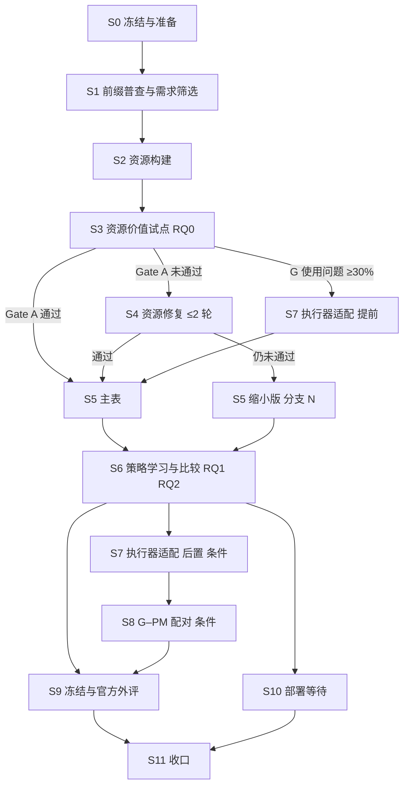

# PM-RL1 完整执行方案 V2

版本：2026-11-16（Asia/Tokyo）。由 Claude 应研究者要求，在审阅 [11-16 主方案](PM_RL1_MASTER_EXECUTION_PLAN_20261116_ZH.md) 后重写。
状态：**研究者确认后生效**。生效后，本文取代 11-16 主方案的工作单（P00–P17）与执行顺序；11-16 的资源合同 [RESOURCE_SPEC_ZH.md](plans/pm_rl1_master_20261116/RESOURCE_SPEC_ZH.md) 仅作字段参考，[OPEN_QUESTIONS_ZH.md](plans/pm_rl1_master_20261116/OPEN_QUESTIONS_ZH.md) 作背景。历史结果、旧锁和旧身份全部保留，不改写。

本方案保证的是：**无论中间结果正负，每一条分支都有写定的下一步，最终都能走到“研究完成”（每个问题有结果或有预先写定的不运行理由，论文和复现包齐全）。**它不保证每个假设都得到正结果。

---

## 0. Codex 怎样使用本方案

### 0.1 入口文件

- 本文件（唯一的执行依据）。
- 状态表：[plans/pm_rl1_v2_20261116/EXECUTION_STATE.json](plans/pm_rl1_v2_20261116/EXECUTION_STATE.json)。
- 决定记录：`plans/pm_rl1_v2_20261116/DECISIONS.jsonl`（一行一个决定：时间、步骤、规则原文、输入数字、结论）。

### 0.2 每次执行的固定流程

1. 读状态表，选第一个依赖已全部 `completed` 的 `ready` 步骤。多个可并行时按编号先后。
2. 按本文对应小节执行：先写代码和 CPU 测试，再跑实际计算。
3. 完成后：
   - 保存产物；
   - 运行该步骤的验收检查；
   - 在该阶段产物目录写一页 `RESULTS_ZH.md`，内容是做了什么、关键数字、与方案的偏差；
   - 更新状态表；
   - git 提交，每个步骤一次提交。
4. 遇到人工标注：
   - 生成标注页面，状态置为 `waiting_human`；
   - 给研究者一条消息，写明页面路径、批次和预计用时；
   - 立即转去做不依赖该标注的步骤（每个阶段都列出了可并行项）。
5. 遇到分支：按本文预先写定的规则判定，写入 `DECISIONS.jsonl`，然后继续。**不另行询问。**
6. 只在 §0.4 列出的接触点联系研究者。

### 0.3 禁止事项

- 重开全项目审计或重读全部历史报告。历史报告只在本文点名时查阅。
- 用旧的 pending 状态覆盖新的完成记录。
- 为同一个测量问题再开一轮判官竞赛。
- 看到相关结果之后修改预先写定的阈值或规则。
- 给未标注的终点填 0。§7.6 规定的显式插补除外，且必须标记。
- 终止或抢占他人的 GPU 任务。被占用时等待，先做 CPU 步骤，不换设备。
- 读取或使用废弃的 80/11-user 合成数据（见仓库 AGENTS.md）。

### 0.4 研究者接触点（只有这五个）

| 编号 | 时机 | 需要研究者做什么 |
|---|---|---|
| T1 | S0 | 一条消息回答三项：① λ：一个“明显更好”的回复最多值得让用户多等几秒；② 第二评审 B 是否可用、每周约几小时；③ 确认采用本方案（即批准 §2 的设计变更） |
| T2 | 每个标注批次 | 打开页面标注，导出 JSON 交回 |
| T3 | S9c（如需付费） | 对给出的精确调用清单、报价和上限回复一句批准或拒绝 |
| T4 | S10b | 提供 Tokkio 服务端点或访问方式 |
| T5 | S2（可选） | 若有具备专业背景的审核人，安排约 2 小时审核 RS 方法单元 |

---

## 1. 研究目标、问题与完成标准

### 1.1 目标

在情感支持对话的每一轮回复前，PM 决定取得哪些外部资源，或者直接停止：

- RS：有出处的方法与案例；
- MP：个人档案；
- ME：事件经历；
- MS：过去的会话。

冻结的 G 用已经取得的资源生成一次回复。要做到的是：回复对此刻的用户更有帮助、更恰当，资源误用更少，等待可以接受。

一个 episode 只包含“获取 → 停止 → 一次回复”。不模拟用户后续反应，也没有多轮未来奖励。

### 1.2 研究问题

| 编号 | 问题 | 回答方式 |
|---|---|---|
| RQ0 资源价值（前提） | 资源组织优化后，各类资源在哪些情境让回复明显更好或更差？瓶颈在链条的哪一段？ | S3 试点（必要时 S4 修复） |
| RQ1 情境选择 | 学到的 PM 在质量–等待取舍和决策正确性上，是否优于最强固定子集、规则、LLM 门控、匹配随机、全开、全关？ | S5 主表 + S6 |
| RQ2 顺序与 RL | 读后再决定是否优于一次性承诺（OneShot）？PPO 是否优于同数据下对精确最优的监督模仿？ | S6 |
| RQ3 执行器适配（条件） | 用相关/无/无关资源对 G 做成组监督，能否提高资源带来的增益、减少误用，同时不降低无资源时的质量？ | S7 |
| RQ4 G–PM 配对（条件） | 换了 G 之后，重新适配的 PM 是否优于直接沿用？ | S8 |
| 外部验证 | 官方 ESC-Eval、ES-MemEval；参考客户端与 Tokkio 实测等待 | S9、S10 |

### 1.3 完成标准

**研究完成**需要同时满足：

- S0–S11 每一步为 `completed`，或为 `not_run_with_reason`，且理由属于本文预先写定的分支；
- RQ0–RQ2 有结果（正或负）；
- RQ3/RQ4 有结果，或按触发规则未运行；
- 外部评价与等待测量已完成，或明确记录了缺少的外部条件；
- 论文草稿与复现包完成。

**预期正结果**：Gate A 通过，且主比较 P1（PM 对 Fixed-best）经校正后显著。没有达到时，按 §12 写对应的论文主张，不改名冒充。

---

## 2. 相对 11-16 方案的设计变更（确认本方案即视为批准）

| # | 变更 | 原因 |
|---|---|---|
| C1 | **先拿科学信号。**S3 资源价值试点只依赖最小资源构建（S2）和本地生成。不等完整编译器、STOP 保护层、训练接口参数化等工程 | 资源有没有增量是整个研究的承重环节。此前多轮同类检验接近 null，应该先用最便宜的方式判别，再决定投入哪些工程 |
| C2 | **动作域有限，并且全部制表。** • 每类资源每轮最多取一个单元，单元大小在 S3 预写规则下确定； • 检索查询只用当前前缀，所以单元内容只由“前缀 + 资源类”决定； • 渲染顺序固定，终点回复只取决于取得的子集，最多 16 个； • 每个可达终点都实际生成并人工标注 | PPO 的每个终点都有可靠奖励，不存在待评轨迹，也不需要等待反馈的 on-policy 批次。11-16 方案列出的“完整域 PPO 缺可靠反馈”的缺口由此消除。本条取代 10/23 去除上限后形成的“无任意上限”动作域定义 |
| C3 | **奖励来自人工判断。**评审判断每个终点回复相对同前缀 OFF 回复是明显更好、差不多还是明显更差，再减去 λ×附加秒数。标注采用列表式页面 | 自动判官对细微差异的分辨率约 .55–.60，J01–J18、SSJ 都没有通过资格。相对 OFF 的人工三值判断是目前唯一可信的信号 |
| C4 | **前缀按生成前的需求线索分层抽样**（记忆需求 / 方法需求 / 普通），不再按 hash 均匀抽取 | 均匀抽样时只有约 10/96 的前缀存在具体信息缺口，PM 学不到“该开”。分层只用生成前可见的信息，并按层分别报告 |
| C5 | **评价采用 18 个 owner 的分组 6 折交叉验证。**任何策略的价值都用表格精确计算；另外对 PM 与最强基线做一组人工直接对比 | 原来只有 3 个 test owner，无法做聚类推断。表格可以精确评估任何策略，不需要再生成 |
| C6 | **两位评审分担主表。**每个前缀的全部终点由同一人标注；20% 的前缀两人都标，用于测信度 | 工时减半，同一前缀内的比较仍出自同一人 |
| C7 | **自动判官只作可选的加速器。**通过资格后才用于扩充训练标签，评价永远不用它 | 判官资格不再阻塞主线 |
| C8 | **RQ3/RQ4 改为条件模块**，触发规则预先写定 | 两者依赖可保留的 G1 是否存在 |
| C9 | **工程规则精简**（§14） | 保留与科学有效性相关的检查，去掉与有效性无关的仪式 |

**保留不变**：

- 11-16 的四资源分工；
- MS-RAW 与 MS-SUM 分开身份；
- 严格过去与同 owner 过滤；
- 所有臂使用同一套栈比较；
- 未知不当 0；
- 共享付费预算账本与上限。

---

## 3. 固定技术栈（S0 冻结）

| 项目 | 固定值 |
|---|---|
| G | Gemma-4-12B-it，路径 `/opt/tokkio-data0/tokkio_models/gemma-4-12B-it-707f0a3`。runtime 与 `outputs/pm_rl1/alternate_executor_probe_20261104_v1/PROTOCOL.json` 的 `runtime` 一致：bf16、sdpa、greedy、`enable_thinking=false`、EOS `[1,106,50]`、`CUDA_VISIBLE_DEVICES=1`（A6000） |
| 生成上限 | `max_new_tokens=320`，按 EOS 自然结束。达到上限时记为 `technical_truncation`，不当作完整回复 |
| 基础提示 B | S0c 冻结。要求口语、2–4 句、不超过 90 词、不编造历史。以 11-11 typed 实验的共同基础指导为起点 |
| 资源块 | 追加在系统提示之后，标题为 “Notes”，内部固定顺序 RS→MP→ME→MS。统一说明：只在对此刻有帮助时使用；不要提到“笔记”；不要编造细节 |
| 嵌入与检索 | BGE-M3，使用 `scripts/rl1/176_probe_qa_resource_gain.py` 配置中的 `bge_local_dir` 同一权重；dense 余弦相似度，L2 归一 |
| 筛选与检查模型 | Qwen3.5-9B（`/opt/tokkio-data0/tokkio_models/paper1_judges/qwen35_9b`），环境 `paper1-qwen35-vllm-py312`，非思考模式，greedy |
| 摘要写入器 | 同 G。提示用 [SUMMARY_WRITER_PROMPT_EN.md](reviews/20261116/pm_rl1_session_summary_design/SUMMARY_WRITER_PROMPT_EN.md) |
| Python | `/opt/tokkio-data0/tokkio_envs/paper1-judges-py312/bin/python`，加 `PYTHONPATH=project/src HF_HUB_OFFLINE=1 TRANSFORMERS_OFFLINE=1` |
| 代码位置 | 新包 `project/src/metacom_pm/rl1v2/`；脚本 `project/scripts/rl1v2/`；测试 `project/tests/test_rl1v2_*.py`；产物 `project/outputs/pm_rl1/v2/<stage>/` |
| 随机性 | 抽样用 `sha256("pmrl1v2|<用途>|<键>")` 排序；训练种子 17/29/43 |

可以复用的现有代码：

- `paper1/data/memory_source.py`、`rl1/data.py`：隔离的数据加载和前缀切分；
- `paper1/multi_view_memory/candidate_adapter.py`：MP/ME/MS 的时点物化；
- `rl1/generation.py:LocalNaturalGenerator`：本地生成；
- `rl1/client_latency.py` 与脚本 154 的测量路径：参考客户端计时；
- `docs/reviews/20261105/pm_rl1_history_necessity/build_review.py` 与 `.../pm_rl1_history_necessity_human_review/ingest.py`：人评页面和导入。

旧的 `organized_*` 学习协调器写死了 96/18 规模和旧的资格检查，**不要改造它们**。表格环境与 PPO 在新包中最小实现（§10）。

---

## 4. 数据与样本

### 4.1 来源

- **EvoEmo**（ES-MemEval 公开版）：18 个 owner、401 个会话，经现有隔离 loader 读取。
- **ESConv train**：只用于 RS 案例。排除与 EvoEmo 有来源重叠的 ESConv 对话（配置中记录的 84 个重叠）。
- **公开方法文献**：用于 RS 方法单元（§5.1）。
- **ESC-Eval**：`data/paper1_authority/paper1_esc_split_large52_frozen_v1.jsonl` 中 121 张 confirmatory 卡，只在 S9 使用。

### 4.2 折分配与 owner 角色

- **6 折，每折 3 个 owner**，按 `sha256("pmrl1v2-fold|"+owner)` 排序分配。原 test owners p4/p7/p14 固定为第 6 折，这样 S9 可以用不含它们训练的 PM。
- **试点 owners**：原 dev owners p1/p15/p18，加上按 `sha256("pmrl1v2-pilot|"+owner)` 从原 train owners 中选出的前 3 个（不取第 6 折）。
- **18 个 owner 全部进入主表。**试点前缀与主表前缀不重叠。另报告“排除 6 个试点 owner、只看 12 个 owner”的敏感性分析。

### 4.3 候选前缀普查（S1）

- 对 `chronological_rank ≥ 1` 的会话，每个“seeker 发言之后紧接 supporter 回复”的位置都是候选切点。
- 前缀 = 该会话开头到这句 seeker 发言。
- 合法记忆 = 同一 owner、rank 严格更小的完整会话，以及由它们派生的资源。

### 4.4 需求筛选（只用生成前可见的信息）

1. **确定性特征**：
   - 回指线索正则，如 `last time | I told you | remember | still | again | update | as I said | since we talked`；
   - 与过去会话的实体重叠数；
   - 求助线索，如 `what should I | any advice | how do I | I don't know what to do`；
   - 前缀与过去会话的 BGE 最大相似度。
2. **Qwen 筛选**（提示见附录 B）。
   - 输入：前缀最后 6 轮；过去会话清单，每个会话给出日期/序号、前 120 词和实体。
   - 输出 JSON：`need_type ∈ {memory_specific, memory_general, method, ordinary}`；`need_spec`（需要的具体过去信息，一句话，附源会话 ID）；`confidence`。
3. **Codex 核对**：对入选试点和主表的每个 `memory_specific` 前缀，打开源会话核对 `need_spec` 是否存在且严格过去，标为 `assistant_verified`。不成立的改标为 `memory_general` 或 `ordinary`。
4. **研究者抽查**：抽 20%，附在第一个 T2 批次中。
5. **分层**：记忆需求 = `memory_specific ∪ memory_general`；方法需求 = `method`；普通 = `ordinary`。

### 4.5 抽样配额

在每个 owner 内按层排序（`sha256("pmrl1v2-sample|"+集合+"|"+prefix_id)`）取前 k 个。同一会话最多 1 个前缀；不够时放宽到 2 个并记录。

| 集合 | owner | 每 owner 数量 | 层配额（记忆 / 方法 / 普通） | 合计 |
|---|---|---|---|---|
| 试点 P | 6 个试点 owner | 6 | 3 / 2 / 1 | 36 |
| 复查 R1、R2（条件触发） | 6 个试点 owner | 3 | 2 / 1 / 0 | 每轮 18 |
| 主表 M | 18 | 8 | 4 / 2 / 2 | 144 |
| 执行器监督与评价（条件触发） | 6 个试点 owner | 剩余池 | 见 S7 | ≤ 156 |

**某层不够时**：先用相邻层补（记忆不足用方法补，方法不足用普通补），记录实际数量。不读取未来内容，不复制样本。

普查给出各层占全部候选的比例。主报告按层分别给出；次要报告用这个比例做“自然混合加权”。

---

## 5. 资源与检索（S2 构建）

### 5.1 RS

**方法单元**

- 数量：目标 24–40 个。
- 来源优先级：
  1. 公共领域的美国政府材料：SAMHSA TIP 35（MI）与 TIP 57（创伤知情），NIMH、CDC 的应对指南，NCPTSD/NCTSN 的 *Psychological First Aid Field Operations Guide*；
  2. 其次是 CC BY-NC-SA 许可的 WHO 材料，如 *Doing What Matters in Times of Stress*。
  每个单元都记录许可。
- 覆盖主题：反映式倾听与核对、情绪确认、开放式提问、问题解决步骤、行为激活、落地与呼吸技巧、睡眠基础、动员社会支持、温和的认知重评、价值澄清、决策权衡、引出改变语言、面对阻抗、悲伤支持基础、自我同情、担忧时间、边界与自信表达、危机安全检查与转介（如 988）。
- 字段：`method_id, name, when_to_use（情境线索）, when_not_to_use, action_options（2–4 条）, example_phrasing（改写，不照抄原文）, limits, source{title, url, section, license, quote（不超过 2 句）}`。
- 由 Codex 依据原文撰写。11-15 的 3 个 TIP 35 草稿并入。

**案例**

- 每个方法最多链接 2 个 ESConv train 完整案例。每个案例包含：前情（不超过 6 轮）、体现该方法的支持者连续行动、紧随其后的 seeker 反应、原始反馈分。
- 召回：用 BGE，以方法的 `when_to_use + action_options` 去匹配支持者轮次，取 top-20。
- 核对：Codex 逐条确认该案例确实体现了这个方法，且不含不安全内容或虚假承诺，然后取最多 2 个。
- 11-15 的 12 张候选卡按其逐卡审阅结论处理：标为“暂停正向使用”的不入库。

**F（常驻紧凑方法）**：全部方法单元的“名称 + 一句何时使用”列表，作为基础提示的可选附加部分。

**专业审核（T5，可选）**：有审核人时，逐单元给出“适用 / 需改 / 不适用”，并据此修改。没有审核人时，在论文中列为局限，不阻塞后续步骤。

**检索**

- 查询：当前前缀最后 3 轮的文本。
- 方法索引文本：`name + when_to_use + action_options`。
- R_m：top-1 方法单元。
- R_p：top-1 方法单元，加上它已链接的案例中与查询最相似的一个。
- D_R：相似度最低的方法单元。

### 5.2 MP

- 用现行 Multi-View 编译结果（713 个 MP 版本），在切点时刻物化当前档案（`materialize_multi_view_candidates`）：先做严格过去过滤，再取最新版本，冲突保留。
- 应用 11-15 的 3 条候选修复：`outputs/pm_rl1/research_preparation_20261115_v1/memory/CANDIDATE_VIEW_REPAIRS_PRIVATE.json`。
- 渲染：事实列表，每条附“报告于 <日期或会话序号>”。
- 超过 350 tokens 时，按与查询的相似度取前 10 条（固定规则）。

### 5.3 ME

- 来源：现行编译的 ME（1,523 条），严格过去。
- 检索：按 BGE 相似度取 top-3。
- 渲染：日期、事件、阶段（建议 / 打算 / 尝试 / 自报反应 / 未知）。编译字段缺少阶段时，附上源原话一句。

### 5.4 MS

- **RAW**：完整的过去会话逐轮原文（现行实现）。
- **SUM**：对 401 个会话分别生成会后摘要，写入器只读该会话全文。保存源 hash 与写入器身份。
  - 忠实性检查：Qwen 逐句判断“是否被原文支持”。有不受支持的句子时，带反馈重写一次；仍失败的，该会话的 SUM 标为 `unusable`，SUM 条件下该会话改用 RAW 并记录。
  - Codex 人工审阅 24 份，必须包含已知的 3 个反例：挂电话、写作工作坊、线上社群支持。
- **检索**：对 SUM 文本建 BGE 索引；RAW 条件也用 SUM 索引排序，保证 RAW 与 SUM 比较的是同一个会话。只检索同 owner、rank 严格小于当前会话的会话。
- **MS 单元**：top-1；若 S3 预写规则判定，则改为 top-2。
- **D_MS**：同 owner 合法过去会话中相似度最低者的 SUM。没有第二个可用会话时，该前缀不设 D_MS，并记录。
- **MS_ORACLE**：`need_spec` 所指源会话的 SUM。只用于已核对的记忆需求前缀。

### 5.5 存储（精简）

- 目录：`outputs/pm_rl1/v2/bank/`。
- 文件：`rs_methods.jsonl, rs_cases.jsonl, mp_versions.jsonl, me_events.jsonl, ms_raw.jsonl, ms_sum.jsonl, embeddings/<head>.npy, embeddings/<head>_rows.jsonl, MANIFEST.json`。
- `MANIFEST.json` 记录每个文件的 sha256、生成代码的 commit 和所用模型身份。
- 每条记录的字段：`id, head, owner, source_session_id, source_rank, source_sha256, text（读者视图）, provenance（原话或跨度）, version`。
- 不要求实现 11-16 完整的 JSON Schema。

### 5.6 资源侧必须有的 CPU 测试

1. 同一 owner。
2. `source_rank` 严格小于当前会话 rank；同一会话的摘要不能用于本会话内部的前缀。
3. RS 不含与当前 owner 来源重叠的 ESConv 对话。
4. 渲染后的 prompt 中没有 gold、未来内容或评价字段。
5. token 数用 G 的 tokenizer 计算。

用反例写测试：未来会话、错误 owner、同会话摘要、重叠的 ESConv 对话。

---

## 6. 决策环境（终点表）

1. **动作**：`STOP, GET_RS, GET_MP, GET_ME, GET_MS`。每类最多取一次；某类没有合法单元时不可选；最多 4 次 GET。
2. **终点确定性**：单元内容只取决于“前缀 + 资源类”，渲染顺序固定，所以终点回复只取决于取得的子集。终点数最多 2^4 = 16（含 OFF）。
3. **观察**：
   - **初始**：前缀嵌入（BGE，最后 3 轮）；各类可用标志；各类 top-1 检索相似度；各类单元的 token 数。这些是读取前就能看到的检索元数据。
   - **每次 GET 之后**：增加该类单元正文的 BGE 嵌入（即内容可见）。NoText 消融不提供这一项。
4. **奖励**：r(S) = y(S) − λ·ΔC(S)。
   - y ∈ {+1, 0, −1}：人工对子集 S 的回复相对 OFF 回复的判断；
   - ΔC：附加秒数（§8）；
   - γ = 1，中间步骤奖励为 0。
5. **性质**：这是一个有限、确定、所有终值都已观测的 MDP，可用动态规划精确求出每个前缀的最优策略。训练折用它做监督；测试折只把它当作诊断上界。

---

## 7. 人工标注协议

### 7.1 评审

- A：研究者；B：第二评审（T1 确认）。
- 两人都不知道各条回复属于哪个条件。

### 7.2 页面（复用 11-05 的页面与导入机制，改成列表式）

每个前缀一屏，包括：

- **当前对话**：英文原文，附中文阅读译文（标明只是辅助）。
- **“这位用户的相关背景”面板**：该前缀所有条件用到的资源单元的并集，中性编号，D 单元也包含在内。RS 单元显示为“可参考的方法说明”。
- **回复 0**：即 OFF，页面不说明它是 OFF。
- **候选回复 1..n**：随机顺序；完全相同的文本只出现一次。

每个候选回复相对回复 0 选择一项：**明显更好 / 差不多 / 明显更差 / 无法判断**。

可多选的标签：

- 正确用到用户过去信息
- 过去信息用错、过时或张冠李戴
- 插入不相关的过去话题
- 重复追问已知信息
- 给出具体、适合的帮助
- 建议过早或不合适
- 不安全或不当
- 太长或不自然
- 其他：___

页面自动保存，可分批导出 JSON。导入脚本校验 `reply_sha256` 与前缀的绑定。

### 7.3 锚点

完整文本见附录 A，要点如下：

- **明显更好**：对此刻这个人的体验有可感的改善。例如：正确用上相关的过去事实或事件；避开用户已说无效的建议；不重复问已知信息；在用户求助时给出具体、适用的帮助；更恰当地处理敏感点。
- **差不多**：只是措辞、语气、长短不同，或者只是提到了历史，但帮助程度没有变化。
- **明显更差**：历史用错、过时或张冠李戴；插入无关的历史；用户想被倾听时急于给建议；内容不安全；明显过长或不自然。
- **无法判断**：只用于无法核实的情况。

### 7.4 校准

- S3 的第 1 批（6 个前缀）由两人都标。
- 对比分歧，讨论 30 分钟，可以修订锚点一次（v2）。此后不再修改。
- 分歧项按 v2 重新标注。

### 7.5 信度

在两人都标的前缀上，报告：三分类一致率、Cohen κ、非平局项的方向一致率。

### 7.6 “无法判断”的处理

1. 交给另一位评审标一次。
2. 仍无法判断，或没有另一位评审：y = 0，标记 `imputed_tie`。
3. 评价时对这些项给出 y = −1 与 y = +1 两个方向的上下界敏感性分析。

### 7.7 工时估计

按每个前缀约 5 分钟阅读、每个候选 30–45 秒估算：

| 阶段 | 内容 | A | B |
|---|---|---|---|
| S3 试点 | 36 个前缀 × 约 11 个候选；B 重叠 18 个 | 约 7 h | 约 3.5 h |
| S4 复查（每轮，条件触发） | 18 个前缀 × 约 5 个候选 | 约 2.5 h | 约 1 h |
| S5 主表 | 144 个前缀 × 最多 15 个候选；A、B 各 72 个，另有 24 个重叠 | 约 22 h | 约 22 h |
| S6 直接对比 | 最多 60 对 | 约 0.8 h | 约 0.8 h |
| S7 RQ3（条件触发） | 36 个前缀 × 7 | 约 5 h | 约 1.5 h |
| S8 RQ4（条件触发） | 48 个前缀 × 15 | 约 6 h | 约 6 h |

所有条件模块都触发时，每人合计约 40–45 h。

**只有 A 一人时**：主表全部由 A 标注（约 36 h），没有信度估计，论文中注明单评审。

---

## 8. 奖励、成本与 λ

1. **y**：见 §7。
2. **成本 ΔC**：用户能感到的附加秒数，即终点 S 相对 OFF 在“客户端发送 → 首个可见文本”上的增加量，包含 PM 决策、检索、编码和 G 预填充的增量。
   - S0e：在参考客户端上实测至少 80 个请求，覆盖从 OFF 到全部取得的 token 范围。
   - 拟合 `seconds = a + b·input_tokens + c·n_GET`，用留一前缀交叉验证计算 MAE。
   - 用该模型给表中每个终点赋 ΔC。完成时间作为次要指标同样建模。
   - S10 用实测数据校准。
3. **λ = 1/X**：X 由研究者在 T1 给出。没有回答时默认 X = 3（研究者此前说过额外超过 3 秒不可接受）。
   - 另外报告 λ ∈ {0, 0.1, 0.2, 1/3, 0.5, 1} 下的质量–等待前沿。
   - 硬约束：ΔC 的 p95 超过 3 秒的终点在部署域中不可选。
4. **训练与评价用同一个 r**，同时分别报告 y 和 ΔC。

---

## 9. 分阶段执行

阶段依赖如下（只画必经路线和条件路线）：

### S0 冻结与准备

**依赖**：无。

**步骤**

- **0a** 建立 `plans/pm_rl1_v2_20261116/DECISIONS.jsonl`，第一条记录为“采用 V2 方案”。建立 `outputs/pm_rl1/v2/`。
- **0b** 发出 T1（一条消息，三项）。等待期间继续做 0c–0f。
- **0c 冻结基础提示 B**：在试点 owner 的非试点前缀中按 hash 取 6 个，生成 OFF 回复。检查长度在 30–110 词之间、口语化、没有编造历史。不满足时修改一次。保存 `B.txt` 及 sha256。
- **0d 冻结其他设置**：资源块模板、生成参数、BGE 身份、查询规则、折分配、试点 owners，写入 `outputs/pm_rl1/v2/S0/FREEZE_S0.json`。
- **0e 延迟模型**：沿用 `client_latency.py` 的路径，新建 manifest；在 GPU1 实测至少 80 个请求；拟合并交叉验证，输出 `latency_model.json`。GPU 被占用时等待，先做其他步骤。
- **0f 回归基线**：运行一次现有 `test_rl1_*.py` 的非 GPU 测试，记录结果。

**产物**：`B.txt`、`FREEZE_S0.json`、`latency_model.json`、`RESULTS_ZH.md`。

**验收**：

- 6 条 OFF 回复全部自然结束且长度合格；
- 延迟模型的留一 MAE 不超过 0.25 s，否则增加样本重拟一次；
- T1 的答复已写入 `DECISIONS.jsonl`。若 T1 超过 7 天未回复，按默认值（X = 3，B 不可用）继续，并记录。

### S1 前缀普查与需求筛选

**依赖**：0d。

**步骤**

- **1a** 普查全部候选切点，输出 `candidates.jsonl`，字段：owner、session、rank、cut、`prefix_sha256`。
- **1b** 计算确定性特征（§4.4）。
- **1c** 用 Qwen 批量筛选全部候选（vLLM），输出 `screening.jsonl`。
- **1d** 按 §4.5 抽出试点 36 个、主表 144 个，并把剩余池登记给 S4 和 S7。
- **1e** Codex 核对 `need_spec`（§4.4 第 3 步）。
- **1f** 报告各层比例和每个 owner 的配额满足情况。

**验收**：

- 前缀中没有未来文本（测试：切点之后的任何一句都不能出现在前缀中）；
- 试点、主表、复查、执行器各集合互不重叠；
- 抽样完全由 hash 决定，可复现。

**可并行**：S2a–S2c（RS 不依赖前缀）。

### S2 资源构建

**依赖**：1d（2a–2c 可提前开始）。

**步骤**

- **2a** RS 方法单元 → `rs_methods.jsonl`。
- **2b** 链接案例 → `rs_cases.jsonl`。
- **2c** 生成 F 文本。
- **2d** MP/ME 时点物化：只物化试点、主表、剩余池前缀实际需要的切点。
- **2e** 为 401 个会话生成 MS-SUM，做忠实性检查，审阅 24 份。
- **2f** 建立 BGE 索引和检索函数。自动诊断检索召回：在记忆需求前缀上，看 MS 检索的 top-1/top-2 是否命中 `need_spec` 的源会话。不需要人工。
- **2g** 编写并通过 §5.6 的 CPU 测试。

**产物**：`bank/*`、`summary_faithfulness.json`、`retrieval_recall.json`、`RESULTS_ZH.md`。

**验收**：

- 每个单元都有来源和 hash；
- SUM 中 `unusable` 的比例已报告；
- 检索召回已报告；
- §5.6 测试全部通过。

### S3 资源价值试点（RQ0）

**依赖**：S2。

**3a 条件**（每个试点前缀）：

| 条件 | 内容 |
|---|---|
| OFF | 只有基础提示 B |
| F | B + 常驻紧凑方法 |
| R_m | top-1 方法单元 |
| R_p | top-1 方法单元 + 最相似的已链接案例 |
| D_R | 相似度最低的方法单元 |
| MP | 当前档案 |
| ME | top-3 事件 |
| MS_RAW | top-1 会话原文 |
| MS_SUM | top-1 会话摘要 |
| MS_SUM2 | top-2 会话摘要 |
| D_MS | 最不相关的会话摘要 |
| MS_ORACLE | `need_spec` 源会话的摘要（只用于已核对的记忆需求前缀） |

约 36 × 11 + 18 ≈ 414 次生成，相同请求去重。

**3b 自动诊断**（不进入奖励）：

- 交付检查：单元确实出现在 prompt 中；
- Qwen 判断“回复中哪些陈述来自资源”；
- 长度和问句数。

**3c 标注**：A 标全部 36 个；B 标其中 18 个。第一批 6 个两人都标，用于 §7.4 的校准。

**3d 预写分析规则**：在回收标注之前，把 3d–3f 的全部规则逐字写入 `DECISIONS.jsonl`。

- **净值**：net = (#更好 − #更差) / n。
- **归因净值**：A_net = (#更好且带机制标签 − #更差) / n。
  - 记忆类条件的机制标签：“正确用到用户过去信息”；
  - RS 类条件的机制标签：“给出具体、适合的帮助”。
- 按层计算，给出 owner 聚类 bootstrap 的 90% 区间（描述用）。

**3e Gate A**

- **PASS_mem**：在记忆需求层，MP、ME、MS_SUM、MS_RAW 中至少有一个条件同时满足：
  1. A_net ≥ 0.20；
  2. A_net − A_net(D_MS) ≥ 0.15；
  3. “带机制标签的更好”来自至少 3 个 owner。
- **PASS_rs**：在方法需求层，R_m 或 R_p 同时满足：
  1. A_net ≥ 0.20；
  2. A_net − A_net(D_R) ≥ 0.15；
  3. net ≥ net(F)。
- **任一通过** → 按 3f 冻结资源设置，进入 S5。
- **两项都未通过** → 进入 S4。

**3f 设计决定**（规则预写，与 Gate 结果无关）：

- **MS 表示**：在记忆需求层，若 net(SUM) ≥ net(RAW) − 0.05，则用 SUM；否则用 RAW。
- **MS 剂量**：若 net(SUM2) − net(SUM) ≥ 0.10，则 MS 单元取 top-2；否则 top-1。
- **RS 单元**：在方法需求层，若 net(R_p) − net(R_m) ≥ 0.05，则用方法 + 案例；否则只用方法。
- **基础提示**：若 F 在全部前缀上的 net ≥ 0.10，且每一层的 net(F) ≥ −0.05，则主表用 B+F 作为基础（此时 RS 获取必须在 F 之上再有增值）；否则用 B。
- **链条归因表**（记忆需求前缀）：
  - MS_ORACLE 未被评为更好时，归入：
    - ① 单元里没有所需信息（表示或写入问题）；
    - ② 有信息但回复没用（G 未使用）；
    - ③ 用了但被评为差不多（内在价值低）；
    - ④ 用错了（G 误用）。
  - MS_ORACLE 更好但检索得到的 MS 没有更好时，归入：⑤ 检索漏。
- **RQ3 触发规则**：在有 ORACLE 的记忆需求前缀中，② + ④ 的占比 ≥ 30% 时，S7 在 S5 之前运行；G1 若成功，主表改用 G1。否则 S7 在 S6 之后运行。

**产物**：`pilot_outputs.jsonl`、`pilot_labels.jsonl`、`pilot_analysis.json`、`attribution.json`、`gateA.json`、`RESULTS_ZH.md`。

**可并行**（等待标注期间）：

- S6 的代码：表格环境、DP、各方法、指标，用合成表测试；
- S10a 参考客户端的准备；
- S9b ESC-Eval 管线的接线。

### S4 资源修复（条件：Gate A 两项都未通过；最多 2 轮）

**每轮的修复选择**：按 3f 归因中占比最大的可修项，选一项主修复，最多再加一项次修复。

| 主要归因 | 修复办法 |
|---|---|
| ⑤ 检索漏 | 查询改为“最后 3 轮 + 抽取出的需求实体”，或增加 BM25/实体通道做混合检索。用 2f 的自动召回指标衡量，不需要人工 |
| ① 表示或写入问题 | 修改摘要写入提示或粒度；修复 MP/ME |
| ② / ④ G 未使用或误用 | 提前运行 S7（RQ3） |
| ③ 内在价值低 | 不修，记录在案。若 ③ 占主导，直接进入分支 N，因为继续修没有意义 |

**复查**：

- 用 R 集的 18 个前缀，只生成 OFF、修改涉及的条件和对应的 D 控制；
- 标注后按与 Gate A 相同的规则判定。

**两轮之后仍未通过** → 分支 N（§12）。

### S5 主表构建

**依赖**：Gate A 通过，或进入分支 N。分支 N 时每个 owner 只取 4 个前缀（层配额：记忆 2 / 方法 1 / 普通 1），共 72 个，取主表抽样顺序的前 4 个。

**步骤**

- **5a** 为主表全部前缀生成所有子集终点：每个前缀最多 16 个，约 2,300 次生成，约 6–8 GPU 小时。相同文本去重。
- **5b** 按 §8 给每个终点赋 ΔC。
- **5c 标注分配**：
  - 按 owner 平衡，A、B 各 72 个前缀；另从各层按比例抽 24 个，两人都标。
  - 每批 6 个前缀。第 1 批结束后检查每个前缀的耗时和平局率。
  - B 不可用时，全部由 A 标注。
- **5d** 汇总为 `terminal_table.jsonl`，每行：`prefix_id, subset, reply_sha256, rater, y, tags, ΔC, imputed_flag`。
- **5e 方差检查**（只看标签，不看任何策略结果）：计算 Always-ALL 与 OFF 之差的前缀间标准差，估算最小可检测效应（MDE）。若 MDE > 0.25，且研究者在 T2 中同意追加约 18 小时，则主表扩充 72 个前缀（每个 owner 4 个）。在 S6 开始之前把这一决定写入 `DECISIONS.jsonl`。
- **5f 判官加速器**（可选）：
  - 用主表已有标注，在相同的列表式输入下评估 Qwen3.5-9B 与 CompassJudger2，以评审标签为参照。
  - 资格条件：判官与人的一致率 ≥（A–B 一致率 − 0.05），且非平局项方向准确率 ≥ 0.75。
  - 通过：可以给剩余池中只用于训练的额外前缀打标签，构成“扩充训练”敏感性臂。
  - 不通过：不用。最多修订提示一次。

**可并行**：

- S6 代码完成后，先用已标注的部分跑通流程；
- S9b ESC-Eval 管线；
- S10a 参考客户端。

### S6 策略学习与比较（RQ1、RQ2）

**依赖**：5d（以及 5e 的决定）。

**步骤**

- **6a 学习性检查**：构造合成表 E0，包含这些情况：不需要资源、取一类即可、两类互补、取了反而有害、成本占主导。PPO 与 Seq-SL 在 E0 上都必须达到 DP 最优值的 95% 以上；达不到就修实现，不进入下一步。
- **6b 训练**：§10 的全部方法 × 6 折。PPO 和 Seq-SL 各用 3 个种子。每折用其余 5 折、15 个 owner 的表训练；测试折只用于评价。全部超参数预先固定，不在测试折上调。
- **6c 计算**：测试折上的策略价值、决策正确性、分层结果和前沿（§11）。
- **6d 人工直接对比**：
  - 在测试折前缀中，找出主 PM（M10，种子 17）与 Fixed-best 选择了不同终点的前缀，随机取最多 60 对；
  - 由没有标注过该前缀主表的评审盲评“对此刻的用户哪个更好 / 差不多”，左右位置随机；
  - 目的是检验“相对 OFF 的三值奖励”能否代表直接偏好。
- **6e 统计**：见 §11。

**产物**：`results_cv.json`、`decision_correctness.json`、`frontier.json`、`head_to_head.json`、`learning_curves.json`、`RESULTS_ZH.md`。

### S7 执行器适配（RQ3，条件触发；运行时机见 3f）

**触发**：3f 的规则，或 S4 选择了 ②/④。若 S6 之后才判断，看 S5 主表中单头记忆终点的“用错”标签率：≥ 15% 时运行，否则 `not_run_with_reason`。

**7a 监督数据**：

- 从试点 owner 剩余池中取最多 80 个记忆需求前缀和 40 个普通前缀，不能与试点、复查和 7c 评价集重叠。
- 每个前缀构造三种输入：
  - 相关：MS_ORACLE，或 `need_spec` 对应的单元；
  - 无：不给资源；
  - 无关：D_MS。

**7b 目标回复**：

- G0 对每种输入采样 4 个候选（temperature 0.7，种子固定）。
- Qwen 检查器过滤：
  - 相关输入：必须正确使用所需信息，且没有错误；
  - 无关输入：不得引入 D 的内容；
  - 无输入：不得编造历史。
- 在通过过滤的候选中，按长度和口语性选 1 个。
- Codex 抽查 30 条。“无”和“无关”的目标回复中不能出现未取得的隐藏信息。

**7c 训练**：

- LoRA：r = 16，α = 32，dropout 0.05，lr 1e-4，2 个 epoch，作用于 attention 与 MLP；
- 环境 `pmrl1_sft_vendor_20260929`；
- 保存 adapter 的 hash。

**7d 评价**：

- 另取 24 个记忆需求前缀和 12 个普通前缀（试点 owner 剩余池，未用于训练）。
- 条件：{OFF, MS_ORACLE, MS（检索）, D_MS} × {G0, G1}。
- 人工标注：每个 G 内各条件相对该 G 自己的 OFF；另加 G1-OFF 对 G0-OFF。共约 252 个判断。

**7e 判定**（预写）。G1 成功需要同时满足：

1. 记忆需求层，net_G1(ORACLE) − net_G0(ORACLE) ≥ 0.15；
2. 误用标签率没有上升；
3. G1-OFF 相对 G0-OFF 的 net ≥ −0.05，即无资源时质量不下降；
4. 普通层 net_G1(D_MS) ≥ net_G0(D_MS)，即不更容易被无关信息带偏。

允许一次有依据的修订（调整目标过滤规则或 epoch）。仍不成功则保留 G0，RQ3 报告为负。

**后续**：

- S7 在 S5 之前运行且成功：主表用 G1；RQ4 需要 G0 的表。
- S7 在 S6 之后运行且成功：主表是 G0；RQ4 需要 G1 的表。

### S8 G–PM 配对（RQ4，条件：S7 判定 G1 成功）

1. 取主表的 2 个折（6 个 owner、48 个前缀），用另一个 G 生成所有终点，按同样的评审分配标注。
2. **PM_other**：在这 48 个前缀上训练，两个折互为训练和测试。**PM_main**：主表上训练、不含这 6 个 owner 的折模型。
3. 在这 48 个前缀上比较四种组合：
   - G_main + PM_main
   - G_main + PM_other
   - G_other + PM_other
   - G_other + PM_main
   每种组合的价值用对应 G 的表精确计算。
4. 报告：
   - 两个 G 下各类资源的 ON−OFF 差，即资源价值是否随 G 改变；
   - 原配与换配的差值及区间。样本小，按描述性结果报告。

### S9 冻结与官方外评

**依赖**：S6（以及 S8，若运行）。

**9a 冻结**：写入 `outputs/pm_rl1/v2/S9/FINAL_FREEZE.json`，包括：

- G、资源库版本、检索设置、基础提示、λ；
- PM：每折模型和全数据模型。主模型为 M10 种子 17，另报告 3 个种子的结果。

**9b ESC-Eval**

- 卡片：121 张 confirmatory 非 ESConv 英文卡。
- seeker：官方 ESC-Role，本地运行，路径 `/opt/tokkio-data0/tokkio_external/ESC-Eval/ESC-Role/2e2a4733d2e71da242f348aad165fe171acd5df7`。实现可参考 `/opt/tokkio-data0/tokkio_runs/claude_esc_pilot_20261111/gen_loop.py`。角色秘密只交给 seeker。
- 轮数：按官方协议；无法确定时用 5 轮，并注明。
- 臂：OFF、Always-RS、Fixed-best（限 RS）、PM（记忆头不可用）。
- 评分：官方 ESC-RANK 七维，使用官方 parser。按卡做配对 bootstrap。
- 说明：这一项只检验 RS 决策。11-12 的实测显示 ESC-RANK 对细微差异的分辨率低，结果如实报告。

**9c ES-MemEval**

- 任务：第 6 折 owners（p4/p7/p14）的官方 QA、Summary、DG。
- PM：用不含第 6 折训练的折模型。
- 臂：No Memory、Full History、Official RAG Top-4、Fixed-best、PM。RS 固定为 OFF。
- 流程：
  1. 先按 `scripts/paper1/84_plan_followup_research_budget.py` 的方式出精确报价；
  2. T3 请求批准；
  3. 执行，使用共享账本，遵守 USD 20 硬上限。
- 不批准或超出预算时：只运行可本地评分的部分，付费部分标为 `not_run_with_reason`。

### S10 部署等待

**10a 参考客户端文本端到端**

- 60 个测试折前缀 × {OFF, Fixed-best, Always-ALL, PM}。
- 顺序交错，先暖机。
- 记录客户端发送 → 首个可见文本和完成时间的 p50/p95，以及 PM 决策、检索、编码、G 各段计时。

**10b Tokkio**

- 在 `/home/tokkio/new_rag/data/app_full_2_tokkiocompat.py` 的**副本**中加入 PM 步骤，不修改原文件；沿用 :8091 上的 policy step1/step2 路径接入。
- 20 条语音话语 × 4 个臂，测量“话语结束 → 首个有效语音”和完成时间，并分段记录 VAD/ASR、PM、检索、G、TTS。
- 需要 T4。没有端点时 10b 标为 `not_run_with_reason`，论文只报告 10a。

**10c 质量–等待前沿**：用表格质量加实测秒数绘制，替代 S6 中基于模型的 ΔC 前沿作为部署版本。

### S11 收口

1. 结果总表：每个 RQ 标为“支持 / 不支持 / 未测”，并注明理由。
2. 分支记录、负结果、局限：
   - 构造人物；
   - 只有 18 个 owner；
   - 评审人数与信度；
   - 有限动作域；
   - RS 方法单元的专业审核状态；
   - 没有独立的英语纵向确认数据。
3. 复现包：代码 commit、全部 FREEZE 文件、终点表、标签、模型 checkpoint 和运行命令。
4. 论文草稿。

---

## 10. 方法与训练细节（S6 前全部固定，不在测试折上调）

### 10.1 共享特征

- **初始观察 x0**：BGE（前缀最后 3 轮）1024 维；每类资源的可用标志、top-1 相似度、token 数 / 1000，共 12 维。
- **顺序方法额外的观察**：每类资源一个是否已取得的标志；已取得单元的 BGE 嵌入，经共享线性层 1024→64 投影，未取得时为 0；再加步数 / 4。
- 数值特征只在训练折上标准化。

### 10.2 方法

| 编号 | 方法 | 定义 |
|---|---|---|
| M1 | Always-OFF | 始终 STOP |
| M2 | Always-ALL | 取全部可用资源 |
| M3 | Fixed-best | 训练折上平均 r 最大的固定子集 |
| M4 | 单头固定 ×4 | 每次只取某一类；仅报告，不作主比较 |
| M5 | Screen-Rule | 依据 S1 的筛选标签：记忆需求 → 取 MS+ME（有 MP 线索时加 MP）；方法需求 → 取 RS；普通 → STOP。规则在 S0 写定 |
| M6 | LLM-gate | Qwen3.5-9B 零样本：给出前缀、各类资源的说明和 top-1 相似度（不给内容），让它选择子集 |
| M7 | Matched-Random | 子集大小按 M10 在训练折上的选择分布抽取，资源类在可用类中均匀抽取；取 100 次平均 |
| M8 | OneShot | MLP 学习 f(x0, onehot(S)) → r̂，在训练折全部终点上用 MSE 训练，3 个种子集成；在可用子集中取 argmax |
| M9 | Seq-SL | 在训练折每个前缀的全部可达状态（16 个）上，模仿 DP 最优动作，交叉熵训练。平局时取 ΔC 更小者，再平局取 STOP |
| **M10** | **PPO-BCinit（主 PM）** | 以 M9 初始化，再用 PPO 训练 |
| M11 | PPO-scratch | 随机初始化的 PPO |
| M12 | PPO-NoText | 不提供已取单元的嵌入，以 NoText 版 Seq-SL 初始化 |
| M13 | Oracle | 测试折 DP 最优，仅作诊断上界 |

### 10.3 网络与超参数

- **网络**：MLP 2 × 128，ReLU，dropout 0.1，weight decay 1e-4；策略头输出 5 个 logits 并做 mask；另有价值头。
- **Seq-SL**：Adam，lr 1e-3，100 epochs，batch 64。
- **OneShot**：Adam，lr 1e-3，200 epochs，batch 64。
- **PPO**：Adam lr 3e-4，clip 0.2，γ = 1，GAE λ = 1，价值系数 0.5，熵系数从 0.01 线性降到 0.001，梯度裁剪 0.5；每次 rollout 256 个 episode，4 个 epoch，minibatch 64；每个种子每折共 30,000 个 episode；训练前缀均匀抽样。
- **测试**：取 argmax 动作。
- **种子**：17/29/43。报告均值和每个种子的结果。

---

## 11. 评价与统计

### 11.1 单位

- 分析单位是前缀，聚类单位是 owner（18 个）。
- PPO 与 Seq-SL 先在每个前缀上对 3 个种子取平均。

### 11.2 指标

- **策略价值**：V(π) = 测试折前缀上的平均 r，汇总 6 个折，每个前缀只在折外评价一次。
- **质量与等待**：质量 Q(π) = 平均 y；等待 W(π) = 平均 ΔC。另报告“更好率”和“更差率”（伤害）。以上都按层报告，并给出自然混合加权版本（§4.5）。
- **决策正确性**：按 `paper1_decision_correctness_evaluation_v1.json` 的指标定义，以单头终点的标签 y({h}) 为每类资源的“开启是否有益”真值，计算 ON-benefit recall、OFF-nonbenefit specificity、unnecessary-open、missed-benefit、balanced accuracy。平局视为“非有益”，单独报告。
- **行动正确性**：遗憾值 V(Oracle) − V(π)；策略达到 Oracle 值的前缀比例。

### 11.3 主比较（预先写定，Holm 校正，3 项）

- **P1**：V(M10) − V(M3)
- **P2**：V(M10) − V(M8)
- **P3**：V(M10) − V(M9)

做法：

- 按前缀配对；
- owner 聚类 bootstrap 10,000 次，给出 95% 区间；
- 用 owner 层面的符号翻转置换检验求 p 值（2^18 种，精确计算）；
- 判为“支持”的条件：Holm 校正后 p < 0.05，且区间不含 0。

### 11.4 次要结果（描述性，给出区间）

- 与 M1、M2、M5、M6、M7 的比较；
- M10 对 M12：读后内容的价值；
- λ 前沿；
- 按层的结果；
- 敏感性分析：
  - 排除 6 个试点 owner；
  - `imputed_tie` 的上下界；
  - 分别只用 A 或只用 B 标注的前缀；
  - 判官扩充训练臂（若有）。

### 11.5 直接对比

报告 6d 中 PM 被偏好、平局、Fixed-best 被偏好的比例，以及与表格推断方向的一致率。

### 11.6 噪声说明

标签噪声会抬高 Oracle 值。用 24 个双评前缀，分别以 A 和 B 的标签计算 Oracle 值，报告两者的差距，作为上界抬高程度的估计。

### 11.7 精度预期

粗略估计：144 个前缀、18 个聚类、ICC 约 0.1，每个前缀差值的标准差约 0.6–0.8 时，标准误约 0.07，80% 功效下的最小可检测效应约 0.2。更小的效应可能检测不到。始终报告区间；“不显著”不写成“相等”。

---

## 12. 结果分支与论文主张

| 分支 | 条件 | 执行范围 | 论文主张 |
|---|---|---|---|
| B-pos | Gate A 通过，P1 显著 | 全部 | 资源优化后，学到的 PM 在质量–等待取舍上优于最强固定子集；RQ2 按 P2/P3 的结果报告 |
| B-fixed | Gate A 通过，P1 不显著 | 全部 | 资源在需求轮次上确有价值，但最强固定子集已经吸收了大部分收益；情境选择没有显示出额外优势。RQ2 照常报告 |
| B-N | 经过 S4 修复后 Gate A 仍未通过 | S5 缩小版（72 个前缀）、S6、S9、S10 | 测量研究：资源优化后，单轮情感支持中资源何时有益、何时有害；PM 学到的主要是“关”（避免伤害与成本）。不主张“学会何时开”。按链条归因写清瓶颈 |

各问题的单独判定：

- **RQ2 为正**：P2 或 P3 显著。
- **读后价值**：看 M10 对 M12 的区间。
- **RQ3 / RQ4**：按 7e 和 S8 的结果判定。

**所有分支都写入论文，不挑选。**

---

## 13. 资源预算

### 13.1 人工

见 §7.7。必经路线（S3 + S5 + S6）每人约 30 小时；所有条件模块都触发时约 45 小时。

### 13.2 GPU（本地，全部用 GPU1 A6000；Qwen 可用 GPU0 A4500）

| 步骤 | 内容 | 估计时长 |
|---|---|---|
| S1c | 筛选数千条 | 约 2 h |
| S2e | 401 份摘要及忠实性检查 | 约 3 h |
| S3 | 约 414 次生成 | 约 1.5 h |
| S5 | 约 2,300 次生成 | 约 7 h |
| S7 | 生成、训练和评价 | 约 8–10 h |
| S8 | 约 770 次生成 | 约 3 h |
| S9b | ESC-Eval：121 张卡 × 4 个臂 × 5 轮，约 2,400 次 G 调用，加 seeker 与评分 | 约 15 h |
| S6 | 训练（小 MLP，CPU 也可） | 不超过 2 h |

### 13.3 费用

只有 S9c 可能付费，走 T3。其余全部本地运行，不产生费用。

### 13.4 粗略日程

| 阶段 | 预计用时 |
|---|---|
| S0–S2 | 2–3 周 |
| S3 | 1–2 周（取决于标注） |
| S4 | 0–4 周（条件） |
| S5 | 4–6 周（取决于标注） |
| S6 | 1–2 周 |
| S7–S8 | 0–5 周（条件） |
| S9–S10 | 2–3 周 |
| S11 | 2 周 |

合计约 3–6 个月。

---

## 14. 工程规则

### 14.1 保留（与有效性直接相关）

- 同 owner 与严格过去过滤；同会话的摘要不用于本会话。
- 每个资源记录都绑定源会话 hash。
- 所有臂使用相同的 G、基础提示、资源块模板和检索。
- prompt 中不出现 gold、未来内容或评价字段。
- 标签绑定到精确的回复 sha256。G、资源正文或渲染方式一旦改变，就重新生成并重新标注，不搬旧标签。
- 未知不当 0（§7.6 的显式插补除外）。
- 按 owner 分组交叉验证；试点前缀不进入主表。
- 阈值与规则在看到相关标签之前写入 `DECISIONS.jsonl`。
- 付费调用使用共享账本，遵守 USD 20 硬上限。
- 不抢占他人 GPU。

### 14.2 放弃或放宽

- 11-16 的 2,000 行 JSON Schema 和 19 合法 / 21 拒绝 fixture：改用简单的 dataclass 校验加 §5.6 的反例测试。
- 逐条记录的规范化 hash：改为文件级 sha256 加回复 sha256。
- development / repair_check / final_confirmation 三用途分流：由交叉验证和“试点前缀不进主表”替代。
- STOP 保护层、`EXPAND_MS`、训练规模参数化改造：表格环境下不需要。
- 每次执行重新审计全仓。

### 14.3 每个步骤的记录

- `input_manifest.json`：输入文件及其 sha256；
- 代码 commit；
- 产物清单及 sha256；
- `RESULTS_ZH.md`。

测试写真实边界：泄漏、表格环境、DP、指标计算。不写“输出等于自身快照”这类测试。

---

## 15. 外部依赖与缺失时的处理

| 依赖 | 缺失时的处理 |
|---|---|
| 第二评审 B | 全部由 A 标注，工时增加；没有信度估计；论文中注明单评审 |
| RS 专业审核（T5） | 列为局限；RS 主张限于“有出处的支持行为资源”，不主张临床有效 |
| 独立英语纵向确认数据 | **不作为本研究目标。**泛化范围写明为：EvoEmo 构造人物上的 owner 分组交叉验证，加 ESC-Eval 外部评价 |
| Tokkio 端点（T4） | 10b 标为 `not_run_with_reason`，只报告参考客户端结果 |
| 付费预算（T3） | 9c 中的付费部分标为 `not_run_with_reason` |

---

## 附录 A：标注锚点全文（页面顶部显示）

> 你会看到一位用户和支持者的对话，以及这位用户过去的一些相关背景。下面有“回复 0”和若干候选回复，都是对用户最后一句话的回应。请把**每个候选回复和回复 0 比较**：
>
> - **明显更好**：如果你是这位用户，此刻会明显更受帮助或更被理解。常见原因：正确用上了你过去说过的相关事情；避开了你说过没用的建议；没有再问你已经说过的事；你在求助时给了具体、适合你的办法；更恰当地处理了敏感的地方。
> - **差不多**：只是说法、语气、长短不同；或者提到了过去的事，但并没有因此更有帮助。**拿不准时选“差不多”。**
> - **明显更差**：把过去的事说错、说成过时的状态、张冠李戴；扯进不相关的旧话题；你只想被倾听时它急着给建议；内容不安全或不合适；明显太长、不像说话。
> - **无法判断**：只在缺少信息、无法核实时使用。
>
> 背景信息可能有用，也可能无关。请不要因为回复“提到了背景”就判为更好。请按“对这个人、在这个时刻”来判断。

## 附录 B：需求筛选提示要点（S1c，英文执行）

- 角色：“You screen a support-conversation turn BEFORE any reply is written.”
- 输入：最后 6 轮；过去会话清单（日期或序号、前 120 词、实体）。
- 任务：
  1. 判断一个好的下一句回复是否需要用户过去会话中的**具体信息**，若需要，指出是哪一条、在哪个会话；
  2. 用户是否在寻求具体的应对办法或指导；
  3. 输出 JSON：`{"need_type": "...", "need_spec": "... | null", "source_session_ids": [...], "confidence": 0-1}`。
- 约束：不写回复；不推测未来；不确定时选 `memory_general` 或 `ordinary`。
- 冻结：提示文本及其 sha256 写入 `FREEZE_S0.json`。

## 附录 C：代码模块与命令（待实现）

### 包 `src/metacom_pm/rl1v2/`

| 模块 | 内容 |
|---|---|
| `prefixes.py` | 普查、特征、抽样、折分配 |
| `screen.py` | Qwen 筛选，批量运行与解析 |
| `bank.py` | RS、MP、ME、MS 构建；摘要与忠实性检查 |
| `retrieve.py` | BGE 索引、过滤、检索 |
| `render.py` | 基础提示加 Notes 块的组装，token 计数 |
| `generate.py` | 包装 `LocalNaturalGenerator`；批量生成；请求去重与缓存 |
| `labels.py` | 列表式页面生成、导入、校验 |
| `table_env.py` | 终点表、动作 mask、DP |
| `policies.py` | M1–M13 |
| `ppo.py` | 最小 PPO 实现 |
| `evaluate.py` | 交叉验证汇总、指标、bootstrap、置换检验、前沿 |
| `latency.py` | 测量、拟合、赋值 |

### 脚本 `scripts/rl1v2/`

每个阶段一个脚本：`s0_freeze.py`、`s1_prefixes.py`、`s2_bank.py`、`s3_pilot.py`（子命令 `generate | page | ingest | analyze`）、`s4_repair.py`、`s5_table.py`、`s6_learn.py`、`s7_executor.py`、`s8_pairing.py`、`s9_external.py`、`s10_latency.py`。

所有脚本统一参数 `--out outputs/pm_rl1/v2/<stage> [--dry-run]`。`--dry-run` 只做 CPU 检查，不加载模型。

### 测试 `tests/test_rl1v2_*.py`

至少覆盖：

- 泄漏：未来会话、错误 owner、同会话摘要、ESConv 重叠；
- 渲染中不出现评价字段；
- 表格环境的 mask 与终点唯一性；
- DP 在已知小表上求得正确最优；
- PPO 在 E0 上的学习性；
- 指标与 bootstrap 在已知数据上的数值。

## 附录 D：与 11-16 工作单的对应关系

| 11-16 工作单 | V2 对应 |
|---|---|
| P00 | S0（只登记本方案用到的旧资产） |
| P01 | S1 |
| P02 | §7 与 S0 |
| P03 | S2 |
| P04 | S2f + S6（表格环境替代在线接口改造） |
| P05 | S0d + S1d |
| P06、P07 | S3 |
| P08 | S4 + S7 |
| P09 | S2f + S4 |
| P10 | S5 |
| P11、P12 | S6 |
| P13 | S8 |
| P14 | S9a |
| P15 | S9b、S9c |
| P16 | S10 |
| P17 | S11 |

11-16 中“完整域 PPO 可靠反馈”的缺口，由 C2 + C3 消除。“独立英语纵向确认”的缺口，按 §15 改为局限，不再作为目标。
