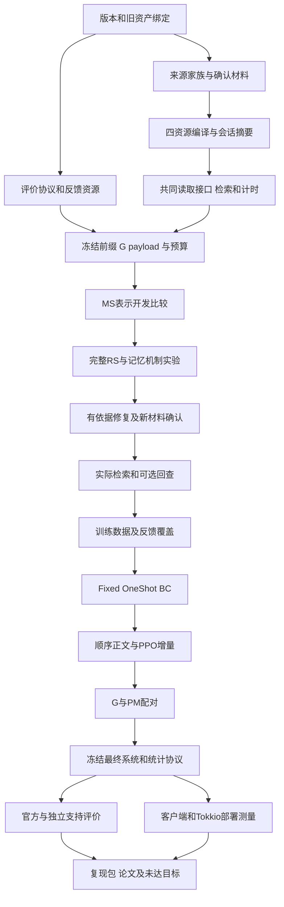

# PM-RL1 主执行方案

> **2026-11-16 更新：本文的P00–P17工作单与执行顺序已由[执行方案V2](PM_RL1_EXECUTION_PLAN_V2_20261116_ZH.md)取代。**本文保留作背景与字段参考。

版本：2026-11-16，Asia/Tokyo。状态：**当前研究方向与候选资源设计已由用户确认；本文是后续工作的主入口，不是实验完成声明。**本轮只整理方案、资源合同及工作单，没有启动新的生成、训练、付费或部署。

## 0. Codex从这里开始

目标是按下述顺序完成资源建设、同版本效用实验、选择学习、顺序/RL验证、外评及部署。不要再从历史pending状态重新开一个路线，也不要要求用户重述已授权的动态获取、执行器适配或会话摘要方向。

每次执行按这个顺序：

1. 读本文件与[执行状态](plans/pm_rl1_master_20261116/EXECUTION_STATE.json)，选择依赖已完成的最前一项工作单。
2. 需要改资源时读[四资源合同](plans/pm_rl1_master_20261116/RESOURCE_SPEC_ZH.md)及[机器schema](plans/pm_rl1_master_20261116/resource_schemas.json)；需要改代码时读[实施映射](plans/pm_rl1_master_20261116/IMPLEMENTATION_MAP_ZH.md)。
3. 执行工作单规定的输入核对、实现、验收与失败处理。每项产物保存source/code/config/request/reply/feedback身份；更新同一状态表。
4. 没有实际产物和对应验收，不把任务标completed。未测反馈保持pending，未确认事实保持unknown。一个任务遇到外部依赖时，继续其他依赖已满足的任务，不重跑全项目审计。
5. 方案中明确选择已作为执行默认值；需要由实验确定的值按规定的开发程序确定并冻结，不逐项反复询问。只有用户偏好/外部资源确实缺失或具体执行范围超出既有授权时，提出一个具体问题，并附可审阅的产物。

辅助文件：[机器工作单](plans/pm_rl1_master_20261116/WORK_PACKAGES.json)、[评价与运行冻结模板](plans/pm_rl1_master_20261116/RUN_FREEZE_TEMPLATE.json)、[未解决问题与分支](plans/pm_rl1_master_20261116/OPEN_QUESTIONS_ZH.md)。这些文件配合本主方案使用；历史报告只作证据追溯，不要求每次重读。

### 授权与历史兼容

用户已接受11/15路线，并在11/16明确要求增加会后summary。新RL1可增加有出处的方法/案例、会话摘要表示与顺序获取研究；旧Paper-1的raw-only MS、四个一阶二元头和70计划等仍是旧实验身份，不覆盖新路线。保留旧结果、旧锁、原标签及缓存身份，不修改历史JSON以假装新实验已完成。

本文取代11/15—16各草案中相冲突的下一步顺序，保留它们的实际结果。后续资源编译和接口改动使用新的版本，不读取或恢复废弃80/11-user来源。沿用共享费用账本与预算；本文件不重置额度。新源、schema、renderer、G或评价变化分别触发受影响项重建，不自动全量重跑。

## 1. 研究目标与完成判定

系统目标不变：在情感支持的当前轮中，按需取得外部方法与个人历史，改善回复帮助性和恰当性，减少误用，并控制用户等待。一个episode只包含获取、停止和一次最终回复；会后摘要是记忆写入机制，不引入多轮未来奖励、模拟心理状态或联合在线训练。

| 问题 | 必须取得的证据 | 不可替代的对照 |
|---|---|---|
| 资源是否提供增量 | 相同G、前缀下完整RS/记忆产生有意义的回复改进 | 无资源、全部紧凑方法常驻、真实错配资源 |
| RQ-S：情境化/顺序获取 | 比固定调用更会选择；读后调整有独立增量 | 强Fixed、匹配成本Random、规则、OneShot、NoText |
| RQ-X：执行器适配 | 改善资源条件性使用，降低误用 | G0/G1各自ON−OFF，不能只看训练NLL或无资源文风 |
| RQ-SX：执行器与PM配对 | G变化后重新适配PM是否优于直接换配 | G0/G1 × PM0/PM1最小原配/交叉矩阵 |
| 部署价值 | 同版本质量—实际等待取舍改善 | 完整客户端路径、Tokkio语音端点、缓存/硬件一致 |

资料存放在模型外部不自动等于有价值。方法常驻即可实现同样效果时保留强常驻基线；个人历史提供当前前缀没有的依据；资料是否补足G能力由实际比较确认。

完成分三个层次记录：

- **实现完成**：数据/资源/环境/反馈/训练/评价/部署路径可复现；不能据此宣称研究目标达成。
- **研究证据完成**：各实际执行的问题有完整结果、误差/失败分析和适用范围。若某假设不成立，保留负面结果，注明哪个目标未达成。
- **预期目标达成**：自然支持资源增量、选择优势及实际等待证据支持相应主张；顺序或PPO优势只在相应比较支持时宣布。不能把只完成QA、有限表选择或无Tokkio的结果改称完整目标成功。

未执行的RQ-SX、缺少独立确认或真实部署，都必须列为未完成范围。方案提供完整推进与止损路径，不能保证尚未测量的假设全部成立。

## 2. 已有资产与本轮起点

| 已有资产 | 当前可用方式 |
|---|---|
| 旧586＋53、1924回复、55人评及Claude池 | 按精确输入/G/实际回复/评价证据复用；不跨版本搬收益标签 |
| 同回复BC/PPO成本负对照 | 复用训练、恢复、缓存与负对照；不作为自然支持正收益 |
| QA86、typed42 | 检索/表示/执行反例与同版本局部诊断；不能变帮助性奖励 |
| 24段历史、15 owners、88条助手来源观察 | 固定源审查起点；不是全库频率或独立人工金标 |
| 3个MP/ME精确对照及候选修复 | 接入新编译视图并验收，旧资源保持不变 |
| 12完整RS案例、3方法草稿 | 来源结构、质量反例及适用性审核起点；不是12张已合格专业正例 |
| 3个完整会话摘要样例 | 检查schema与写入提示；不是自动摘要器效果 |
| 官方ESC与ES-MemEval代码、模型 | 后期共同冻结外评；官方原协议和内部单轮反馈分开 |

上述产物入口：[11/15实物](reviews/20261115/pm_rl1_resource_organization_and_execution/RESULTS_ZH.md)、[11/16摘要设计](reviews/20261116/pm_rl1_session_summary_design/DESIGN_ZH.md)。本次不重新填写已完成的人评，不补完全部旧评分作为新研究前置。

## 3. 新四资源的内容、组织与存储

详细字段、类型及可见性以[RESOURCE_SPEC_ZH.md](plans/pm_rl1_master_20261116/RESOURCE_SPEC_ZH.md)为准。四种逻辑资源保持RS、MP、ME、MS；MS的RAW/SUM是同一来源的两种表示，回查是获取操作，不是第五类知识。

| 资源 | 存什么 | 逻辑组织 | 运行时交付 |
|---|---|---|---|
| RS | 方法出处、适用线索、行动选项、限制；案例前情、连续行动、随后反应及未知 | `method`与`case`关联；解释、作者标签、观察反馈、审核结论分栏 | 版本化方法或完整案例单元；打包时固定组成/排除/成本，不偷偷删坏片段 |
| MP | 截至目标时点有效的稳定事实 | 槽位版本、直接证据、有效/被更正/冲突/未知；当前视图按cutoff重建 | 自足事实及时间/不确定状态；不放临时情绪和回应偏好历史 |
| ME | 事件、经历、变化、约束、行动和主观反应 | 事件时间线；建议/意向/尝试/自报反应分别保存，有依据才关联 | 可独立理解的历史事件；一次拒绝的范围、结果未知等保留 |
| MS | 每次完整会话原文，以及仅从该段生成的会后摘要 | 同源`RAW`与`SUM`分别版本化；摘要保存会话发展、支持过程、用户反应与未解决事项 | S1固定RAW或SUM；S2另测摘要＋显式原文回查 |

采用**JSON/JSONL作为可审计的主数据**：来源快照、资源记录、证据映射分别保存；SQLite及向量文件仅是可重建的检索索引；反馈和未来答案放在独立评价域。无需先迁移到大型图数据库。原文与审计引文保留，紧凑reader payload不默认携带所有审计字段。

写入流程：完成的来源 → 来源hash/时间/家族登记 → 新资源候选 → 结构与来源校验 → 语义/适用性处置 → 冻结可用版本 → 索引。摘要、MP、ME都直接绑定原文，不把摘要作为唯一事实来源。新会话更新当前MP和ME，旧摘要保持“当时发生过什么”，纠错从原文重建。

长期增长由独立会话摘要、索引和按需获取共同处理。不得把所有摘要持续拼入prompt。保留原文检索入口，防止摘要遗漏的信息永远失去可达性；旧资料不因年久自动为无用。存储和索引仍会增长，其成本另报。

## 4. 现在固定的选择与需要执行后确定的值

| 项目 | 执行规则 |
|---|---|
| 开发G | 优先沿用11/11已运行的Gemma候选与实际runtime身份，先核基本回复与部署可行性；不按RS增益选G。正式提升另存freeze |
| 写入器 | 首次采用上述已可运行本地模型作为工程起点，独立writer/prompt身份；24源小批检验保真。助手手写样例不能作为其效果。一次有依据修订仍失败则保留RAW并列出写入器缺口 |
| 共享检索 | 固定BGE基线，保留词重叠对照；先按来源/owner/时点过滤。actor/critic只见公共前缀与已取得信息 |
| 初始动作域 | STOP与四类GET；无任意top4/四次GET/2048资源上限，只有冻结接口、有限库存与原生容量。GET不调用G/J |
| MS比较 | 先同来源、同排序、同G比较RAW/SUM；不同时优化检索。混合回查单独版本，所有基线共享能力 |
| 生成 | 实际EOS/EOT自然结束，记录技术中断；不把任务级硬截断当完整回复。配置/软件/设备/缓存身份冻结 |
| 反馈 | 新配对协议独立命名。旧q/m资格、官方ESC分数、策略标签不能直接当新奖励 |
| 成本 | 质量与秒数分开保存；训练权重/约束在开发选择并冻结。不从3秒推λ=1/3。额外约3秒仅为待验证部署情景 |
| 随机性 | 初始确定性生成沿用runtime；正式学习种子17/29/43。单次确定性重复不增加样本独立性 |
| 数据单位 | owner/原始对话/视频/ESConv种子及派生家族；完整家族登记用于隔离，同一人多轮不当新人 |
| 学习规模 | 不用12＋24机制样本冒充训练集。原96/18仅为历史开发起点；新manifest按实际可用家族/反馈覆盖建立 |

需要执行后产生的值包括实际可用源量、合格摘要数量、反馈分歧率、正式样本量和部署吞吐。每项都由下列任务给出生成方法与验收；不是留给执行代理随意填数。

## 5. 工作顺序及阶段产物

工作单的逐项依赖、状态、输出和失败分支在[WORK_PACKAGES.json](plans/pm_rl1_master_20261116/WORK_PACKAGES.json)。可并行做来源/评审资源盘点和CPU接口，但必须按数据依赖冻结后再运行模型。

P13的交叉实验以存在可保留G1为条件；不存在时登记未回答并进入其他已可评价工作，不伪造G1。P16可以提前实现技术桥接，正式计时必须等待最终冻结。外部依赖未满足时，不能将整个DAG末端标为完整目标达成。

### P00—P05：建立可运行实验包

**P00 版本绑定。**复用39项hash和资产复用表，加入本次schema与summary版本。建立唯一run_id及父版本，不重开全仓审计。新payload固定后才逐条连接旧缓存/人评。所有未连接条目状态为pending，不预报复用数量。

**P01 来源与分组。**先接纳现有24段、12案例、3方法草稿；补AnnoMI来源/视频家族与方法原文，记录纳入和排除理由。用途固定为`development / repair_check / final_confirmation`，并保存历史曝光。源质量审核在看目标效果前进行，不能挑“能赢”的案例。EvoEmo旧test不改名未见集；独立英语纵向来源不足时按P01分支继续开发并单列正式确认缺口。不会用AnnoMI或ESC角色冒充纵向历史。P08用于选G/表示/检索的repair_check已经参与系统选择，不得再当P15最终确认；final_confirmation的家族须另留出。

**P02 评价协议与资源。**准备共同的前缀/合法证据/双回复盲评界面、换序、原始判断、分歧和来源错误字段，按第6节定义。指定真实评审供给与时间；单人可以开发，不能伪称独立双评。选已有反例及普通情境做有限校准，避免反复裁判竞赛。专业适用性审核不足时使用有出处的普通支持行为范围，专业能力主张保持未验证。

**P03 资源编译。**按schema实现来源和视图物化；将3处候选修复整合到新版本。先用24段历史生成每会话独立摘要，复查角色、指代、时序、更正、行动阶段与遗漏；原文保留。每个摘要仅在其源会话之后合法。RS方法/案例分开，不将ESConv标签或反馈当专业结论。source-bound不等于语义正确，结构失败和语义问题分别记录。

**P04 接口。**新增表示适配，处理`existing_item`、`directory`和`match_session`的raw-only假设；接统一BGE与source lineage；新增实际秒数成本适配和新反馈接口；将硬编码训练规模参数化；预留独立只读heldout构造路径。CPU测试必须覆盖未来/错误owner、未知谱系、summary原文hash变化、未读正文、GET不调用G/J、缺测不填零及缓存身份。

**P05 冻结。**产生12开发＋24诊断前缀候选清单，按生成前线索覆盖普通、方法相关、历史相关及组合情境；允许不适用，不伪造M。前缀若无法满足合法源与分组规则，输出真实数量及原因，先补源，不能机械填满36。固定G/资源/提示/检索/反馈/seed/时间/实际请求清单及预算。冻结模板不得留下未解析字段却标ready。

### P06—P09：解决表示、资料、执行与检索问题

**P06 MS表示。**在开发前缀比较OFF、RAW、SUM；其他资源、来源集合与排名相同。RAW/SUM共同可行集做配对，容量差异另报；不得裁短RAW。第一批最多12×3=36个位置，精确同OFF可复用。SUM＋RAW诊断及混合回查不自动加入本批。根据保真、误用、帮助性与实际等待决定下一版默认表示；不足以选择时保留RAW主身份、SUM实验身份，不将词数优势当质量结论。

**P07 机制实验。**开发12与冻结诊断24采用B、F、R、M、MF、MR、D_R、D_M八条件：共同基础指导；F是全部紧凑方法常驻；R/M直接提供合法完整资料；错配资料有真实来源但不预设零收益。七项比较R/B、R/F、M/B、MR/M、MR/MF、R/D_R、M/D_M。最多288个位置，加P06上限共324个位置，去重后实际数另计；这是工程预算而非功效结论或已执行数量。直接提供不是自动检索成绩。

每个回复记录资料是否充分、准确采用、帮助性、误用和成本。即使正确交付后G未用或用了更差，也保留为实际结果。只有身份/交付/执行失败使相应测量pending/invalid，不能删去不利语义结果。

**P08 针对性修复。**按主要失效位置选择一次有证据的初始修复周期：源不足补源；表示失真修写入；充分资料未被正确使用则做相关/无/无关资源成组SFT；量表不清则修锚点并重评原回复。OFF示范不得透露隐藏历史。固定开发样本验收技术修复，新增来源材料确认泛化。继续修订须有新错误机制和新的预算/版本记录，不能同配置反复抽到显著。记录G0/G1各自ON−OFF，保存无资源退化及所有失败。

**P09 实际检索。**比较直接提供、共享BGE、词重叠三种路径，检查有效资料召回和最终帮助性保留。先修已证实的检索漏项，再交给PM。只有S1后仍有实际回查需求才实现MS混合接口；`EXPAND_MS(j)`只选择已读摘要的可见序号，内部绑定原文，计实际成本并对全部基线开放。未实施时明确没有此动作。

### P10—P13：产生真实训练反馈并学习

**P10 训练资料。**机制样本用于确定设计；训练前缀与最终确认分开。扩展合法train前缀/来源家族，不把更多切点当更多人物。新训练manifest记录group、反馈覆盖、资源/检索/G身份。每个实际终点生成只调用一次G，随后取得对应反馈。未评分终点进入pending队列，支持恢复，不给奖励零、不按效果挑删。

**P11 简单选择先行。**先完成OFF、常驻方法、固定单/双单元、Fixed-Dev、匹配实测成本Random、可复现规则、初始承诺OneShot及BC。Random只用开发实测校准并冻结随机策略/预算分布，确认阶段只测实际成本差，禁止按确认集耗时事后挑匹配动作。OneShot只能用初始可见信息选择程序，不偷看未来正文或用未来可行性oracle筛程序。搜索预算在开发固定，报告候选数/耗时/可行率；预算加倍的开发敏感性用于判断是否过弱，不在测试上追搜。BC-init与BC-union分开，所有方法获得共同反馈池。

预承诺程序途中可能因原生容量或该头耗尽而不可行。**本版选择实现显式的共同可行性保护层**：若下一次GET仅因这两种机械原因不可执行，记录原请求、mask与原因，执行STOP并用已得资源生成；不跳到另一条资源或另一头。全部方法共用保护层，OneShot命名为`OneShot-Guarded`，这种机械停止不称为读懂内容后重规划。来源/hash/owner错误、模型故障不适用此规则，仍为invalid/pending。当前旧`step/replay_program`会raise且无fallback；P04必须新增并验收这一接口版本，不允许运行时临时补STOP。记录计划与实际程序及触发率，已发生的控制/检索成本照计。

**P12 顺序与PPO。**先比较读后正文可见与NoText，再比较BC-init/BC-union/PPO；NoText若共享检索仍使用已读正文，只能解释控制器可见性，另设固定查询对照检验检索更新。新秒数/反馈接口、参数化样本规模通过验收后才能复用优化器。正式种子17/29/43，完整保存优化和反馈预算。

每批rollout固定策略快照与log-prob，等待该批反馈后按声明的PPO更新规则处理。不能在等待人工评分时持续换策略，再把旧轨迹当当前on-policy批次。跨版本或过旧轨迹可进入共同监督池；未经另行验证的离策略修正不纳入本方案默认实现。

有限人工表只能支持其覆盖的选择任务。完整域PPO必须为新终点继续取得可靠反馈：rollout产生pending→实际G→可靠反馈→纳入共同池→更新。没有反馈资源时先完成有限方案选择，**完整域PPO保持未完成**；不得偷偷mask未知方案后仍声称原无任意上限域已验证。有限域实验独立命名并让基线处于同域。

**P13 执行器配对。**若P08保留G1，分别训练PM0/PM1，在相同合法目标上比较G0+PM0、G0+PM1、G1+PM0、G1+PM1；反馈分别绑定各G实际回复，训练预算公平，简单基线在两G下都保留。不自动恢复更早的大规模交叉网格；没有G1则不宣称回答RQ-SX。

### P14—P17：正式评价、部署与完成

**P14 总冻结。**冻结全部已选择模型/资源/检索/动作/反馈/操作点、独立评价清单、统计和运行预算。建立只读evaluation用途路径，不能把heldout改名dev来绕过现有检查。测试输出不能回流训练或挑模型。观察结果后需要改系统则形成新开发版本，不能继续称同一确认。

**P15 外评。**同一最终栈运行官方ESC-Eval七维，ES-MemEval适用QA/Summary/DG原协议，以及独立自然支持评价。ESC-Role秘密只给模拟seeker；DG鼓励记忆展示，不能当自然支持奖励。原官方组与新资源组标明差异，静态官方基线及组件消融完整保留。自动评分和人评分歧如实报告，不换成最有利总分。

**P16 部署。**先用现有本地参考客户端测试全路径，再接实际Tokkio服务。记录用户端请求前到首个有效内容/完成，以及语音结束到首个有效语音/完成；区分VAD/ASR、PM、检索、编码、G、TTS、排队。固定硬件、并发、缓存冷暖与运行顺序；不占用或终止其他项目任务。没有Tokkio端点只能完成参考客户端结果，不能宣布真实语音部署目标达成。

**P17 收口。**交付数据/模型/版本manifest、可重建索引、参数与运行命令、全部条件/失败/排除、学习曲线、分组置信区间、质量—等待前沿、资源与策略错误案例、曝光说明、论文草稿与复现说明。清楚区分已经支持、未支持和未测试的主张。发布/共享按实际授权和来源条件处理，不能把private评价域或受限源全文自动纳入公开包。

## 6. 评价、训练反馈与统计规则

### 6.1 帮助性定义与不确定

总体配对主判断：在相同当前前缀与合法证据下，哪一回复对用户更有帮助且合适。标签为A有意义更好/B有意义更好/相当/不确定；“语气稍顺、较长、多引用”本身不足以构成有意义更好。锚点包括正确利用重要约束、避免已失败建议、减少重复追问、恰当地澄清或支持；不强制唯一支持策略。

证据事实、资源采用、专业适用性、整体帮助性分别记录，不能把一个代替另一个。两位评审独立且不知道模型/条件；分歧先保留，再单列复核。助手评审不是第二位人类。只有一人时继续开发，标明来源。

报告W/L/E/U全计数与覆盖率。可辨部分净胜率为`(W-L)/(W+L+E)`；同时给全体可能范围`[(W-L-U)/N, (W-L+U)/N]`。不确定不是零收益，不通过删除全部争议样本扩大正面结果。人评工时：24诊断×7对×2人为最多336判断，按2—5分钟约11.2—28小时，未含校准/专业审核；P06和训练新终点的判断另计。

### 6.2 配对标签怎样进入训练

七项机制比较本身不构成完整标量终值表。每个需要训练的终点须有**与同前缀冻结OFF实际回复的直接比较**，或经单独验证的绝对回复质量测量；不能从R>F、F>M传递推出R相对OFF的精确收益。

最小新反馈合同可使用直接OFF比较的材料偏好符号：更好+1、更差−1、相当0，明确这是基线相对序数代理，不是心理效果单位；不确定/缺测不入已测奖励。多个评审记录及其分歧保留，不假装无噪声真值。资格和解释另立版本，不伪造现有qualified q/m签章。自动裁判只在其已核验范围承接反馈。

待评是`pending_score`；已经完成评审但不确定，最多按预定流程复核一次后记为`completed_uncertain`，判定保留而score为null。它不无限等待、不填0、不进入要求标量奖励的更新。报告这部分的情境分布、比例与学习覆盖；只在可辨子集上的结果不能宣布覆盖全域质量。

秒数是另一字段。第一版使用终值奖励`r_quality − λ × C_online_total`，C包含冻结客户端边界内PM、检索、编码、G和其他在线开销，排除离线建库与人评等待；GET不再另扣同一成本。若以后改为逐步成本奖励，必须证明逐步与终值分段无重复、无遗漏。TokenCost不能仅改变量名当MeasuredSeconds。每个成本反馈绑定实际路径与负载/缓存协议；旧回复重放不是新的延迟观测。

开发阶段在质量与等待两个轴上选择操作点，再冻结`reward_contract`；λ由开发的质量—等待选择产生并记录候选范围/预算，先交强质量优先基线，不为得到PPO正数任意调λ。未知终点只进待评队列。自动成本近似若另行引入须标明预测秒数并验证，不能冒充实测。

### 6.3 统计与样本量

12开发/24诊断不是正式功效保证。机制七比较完整报告并视为开发诊断；最终主要比较预先限定为：最终情境PM对强Fixed、顺序PM对OneShot、PPO对BC-union。RQ-X/RQ-SX与MS表示另报，不临时挑显著项称主要终点。正式多重检验默认Holm校正，family及比较必须在P14冻结。

按独立owner/来源家族聚类，报告有效家族数；同源多轮、多个seed、多个评审不增加独立样本数。先报告效应与区间；家族太少时不依赖大样本近似制造精确p值。普通情境与挑战层分别报告，若无已知总体抽样权重，不给虚构自然需求率。

P02/P14根据开发估计的分歧、效应和组内相关性做分组功效模拟，输出正式样本量及可用来源是否足够。初始规划情景可取净有意义胜率差0.10、功效0.80和familywise α=0.05，并明确这是工程规划假设，不是普适临床阈值或事后成功门槛；同时给相邻效应情景。所需独立家族超出现有量时，补源或报告估计性研究，不能用重复前缀补足N。

正向帮助性主张要求预定比较支持正效应且不被严重误用解释。没有显著差异不等于非劣；要走“质量非劣＋更快”路径，必须在相应结果解盲前用锚点确定并冻结非劣界限，否则只能报告区间和取舍。追加样本/中期查看规则在P14固定，不能测到满意才停。

## 7. 费用、计算、缓存与恢复

- 继承2026-09-18起共用约USD10计划、USD20硬上限及不可重置的累计边界；执行前核实际已结算/在途/预留。模板不预填余额，不创建新额度。付费路径接原子预算；本地任务无付费自动回退。
- 生成位置、写入器调用、重试、裁判、模拟seeker分别计数。最多324是初始机制/表示位置上界，24段摘要写入、训练反馈、确认、外评、部署均不在其中；最终成本由实际manifest逐项计算。人工/专家工时不能冒充API额度内已解决资源。
- GPU时间同样记录。先检查指定硬件空闲/原合同要求，不移动到其他设备后仍宣称同栈，不终止他人任务。
- 缓存精确绑定source/cutoff/资源顺序/messages/G权重adapter模板解码/draw/实际reply；反馈再绑定原证据与量表。相同缓存回复不产生新的延迟观测。
- 修解析只重解析；修评价先重评原回复；改变资源正文、G、renderer才重生成受影响请求。技术失败/unknown调用状态进入恢复队列，不能自动重试导致预算重复或将失败当差回复。
- 写入成本与在线读取成本分开，给实际或明确假设查询次数下的摊销。摘要减少词数不等于更快，离线异步也可能争用GPU。

## 8. 仍未有确定答案的事项

完整清单见[OPEN_QUESTIONS_ZH.md](plans/pm_rl1_master_20261116/OPEN_QUESTIONS_ZH.md)。这里给研究推进所需的关键区分：

| 状态 | 事项 | 推进方式 |
|---|---|---|
| 有明确工程解法，尚待执行 | 四资源结构、时点/来源、摘要版本、共享检索、秒数/新反馈适配、可配置训练manifest、只读评价路径 | 按P03/P04实现并CPU验收，不再泛泛讨论 |
| 有明确实验，答案未知 | 完整RS是否补足G、SUM是否优于RAW、G条件监督是否有效、顺序/PPO是否胜基线 | P06—P13固定对照；有依据修复，保留失败范围 |
| 没有现成可靠闭环 | 完整域自然支持PPO的新终点如何持续取得可信且负担得起的反馈 | P02/P10建立人评/经核验自动反馈供给；缺供给时只能完成明确有限域，完整域目标仍未完成 |
| 尚缺外部资源 | 独立英语纵向确认、专业适用性审核、独立帮助性评审 | P01/P02定向获取；当前公共候选不能自动替代这些东西 |
| 尚缺实际接入信息 | Tokkio端点/语音桥接、最终负载和可用计算/费用 | P16技术桥接与费用核对；不能以本地组件秒数冒充部署 |

这些缺口不会阻止所有前置开发，但确实限制对应主张。没有可靠答案的地方不能靠在计划里写“进一步优化”来消除。也不能将“有失败后的诚实分支”描述为已经保证完成全部预期正目标。

## 9. 交接与下一执行单

下一次Codex执行从P00登记开始，随即并行P01来源清单与P02评价资源盘点，再实施P03/P04。**本次用户要求先整理完整方案，当前不启动新实验。**执行代理应先交付可读资源样本和CPU验收，再按已冻结清单进入模型工作；不再次请求研究方向确认。

关闭阶段时更新：工作单状态、实际输入/产物hash、检查命令及结果、模型/人工/费用使用、未解决问题、受影响的后续任务。任务状态只允许pending/ready/in_progress/completed/blocked_external/not_run_with_reason，不把候选、已实现、已验证混为一谈。

整个研究收口前检查：所有计划比较均有结果或明确未执行理由；所声称的目标都有对应证据；没有把未知填零、跨G复用标签、源家族泄漏或把模拟/QA成绩当真实支持收益；正式数据未被用于选模型；部署与费用记录完整；复现包能够重建实际系统。达不到的条目留在未完成清单，不以“论文已写完”代替目标完成。
