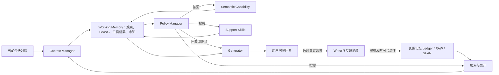

# 语义工作记忆与能力感知陪伴Agent

候选方向：**Semantic Working Memory and Capability-Aware Adaptive Decision-Making for Long-Term Companion Agents**。核心目标仍是用户目标完成、可靠性、自然交互质量、适当获取与停止、实际等待。token仅解释成本。不以本轮技术失败或旧受限动作域结果否定更完整POMDP，也不为保留POMDP而强求序贯胜出。

## 逻辑架构与现有接点

这是逻辑职责，不要求八个模型，也不要求每轮依次运行。普通问候、当前信息充分的交流可直接回复，M0+R0及不调用语义能力均为合法成功路径。

| 层 | 当前可复用资产 | 当前状态/职责边界 |
|---|---|---|
| Working Memory | 当前原生对话、GE2已读范围、GSWS解释与父版本 | GSWS为核心组成；当前解释无语义资格；增加工具结果不能自动增加“已确认事实” |
| Long-term Memory | SourceRegistry、As-of、Ledger、RAW/SPAN、MP/MS/ME接口 | RAW/SPAN可用，MS-SUM导航；MP/ME候选仍pending/mask |
| Semantic Capability | 新事件证据工具、既有NLI接口、Paper1 grounding/versioning | 能力候选明确输出范围和未知；精确引用不证明含义 |
| Support Skills | 既有有来源RS与程序性方法 | 不扩同类原则卡，不将未审核CASE当专业正例 |
| Context Manager | GE2去重、时间排序、区间读取、容量与renderer | 确定性组织及交付；不决定资源是否有价值 |
| Policy Manager | GE2动作/观察、剩余预算、实际时钟 | 未来选择信息和能力；当前GSWS固定供证尚未测试该决策 |
| Generator | 原Gemma、原生角色、同源RAW及未验证解释 | 不预设能力永远足够；保留强模型参照 |
| Writer与反馈 | 旧Writer、可追溯版本链、来源定位 | 离线历史理解不见未来测试目标；真实更新语义仍待验证 |

用户说“我尝试了某方法，感觉有所改善”是用户经历的自报信息；不是PM调用该技能成功的因果标签。Agent自己的耗时、异常、可复核错误和后续反馈另记，不能混入用户事实库或直接作自然支持reward。

## 最小接续路径

当前已能运行的接点为`actual GE2 observation → gsws.project/model_evidence → event_understanding.invoke_from_gsws`。工具只能看到实际已读话轮，返回同一来源ID；后台保留观察版本及工具结果身份，PM/G可共享同一候选解释。没有将新能力接进本次冻结GPU三臂，也未声称完成能力调度实验。

未来独立机制中，沿现有SEARCH/EXPAND保留原信息隔离；增加有范围的`INSPECT_EVENT(proposition,evidence_ids)`与有限RS读取；`REPLY`和`CLARIFY`均为终局回复决策。工具不得自己读取隐藏正文；若候选命题依赖未读证据，必须回到合法获取动作。状态更新作为调用后的内部操作，不强制多消耗一个LLM步骤。

状态分别表达：可见用户目标/边界、带说话人与时间的原文、待核验语义候选、明确未知/冲突/不适用、已执行动作及实际剩余时间。目标理解可以不确定，不能将推测的隐藏需求写成硬目标。时间状态由宿主单调时钟计算；当前600秒实验守卫和300秒终局预留不是经验证的用户体验门槛。

工具结果只有在其引用仍合法、可见且可追溯时进入共享状态。发生新报告时保留旧报告时间、旧阶段及修改依据；不采用“新claim自动使旧claim为假”，也不让模型自报充分性自动授权停止。需要未知时允许澄清或有边界的自然回应。

## 能区分研究问题的最小实验顺序

1. **同信息语义表示**：先完成当前8目标×S0/S1×RAW/Notes/GSWS；不增同类任务。本批两个固定供证状态只能检验解释及更新，不检验自适应决策。
2. **专业能力增量**：若事件、角色或未知缺陷在供证充分时仍存在，保留相同RAW与G，仅比较已有理解流程是否调用一次明确范围的事件能力；使用不同来源的语义与自然前缀，包含完全无需调用的状态。先固定能力输出、评价与时间预算，不因生成效果改案例。
3. **共享状态与自适应调度**：只有能力改善及状态增益可辨别后，准备同来源、同可行动作、同预算的最小2×2：有/无共享状态 × 固定/自适应调用。普通LLM Tool Agent与轻量规则候选共享全部合法信息/工具，强静态可以一次取足，不能人为删掉其可用来源。明确记录哪条实际工具结果改变了后续可行动作与终局质量。

上述不是本轮已获批GPU包；当前只提交日志技术恢复的具体执行申请。较强G比较独立列出模型成本及语义配置，不把换模型收益混为状态收益。若能力本身未可用，先研究明确语义任务，不靠策略学习掩盖能力不足。

## RQ与收口条件

| 研究问题 | 已有实际证据 | 当前决策 |
|---|---|---|
| RQ1：来源绑定的事件/角色/时间/目标理解是否可靠？ | 历史错误保留；新NLI对话CPU发现主体误支持；MAVEN监督坐标可用但24项异常 | Event Understanding继续；不能宣称语义瓶颈解决 |
| RQ2：可更新共享理解能否优于RAW及普通笔记？ | 输入及状态链CPU接通；此次真实语义输出0 | 完成原固定实验；不做优劣判断 |
| RQ3：语义能力及状态能否改善获取、不获取、继续、停止与回复？ | GE2提供可复用环境；当前没有新调度端点 | 保留为假设，不启动BC/价值学习/PPO |
| RQ4：改善是否值得实际等待？ | 真实失败启动75.819秒；CPU工具有实测；GSWS在线回复无计量 | 记录解释、工具、PM、G首字/完成、冷启动，不用token代理 |

如果Notes解释全部增益，停止“专门结构有独立优势”的主张，可保留工作记忆职责和简单笔记实现。如果同信息的更强G解释全部增益，转向能力—成本选择，不声称状态独立贡献。如果强静态解释决策收益，停止当前序贯优越性主张，但保留任务范围更完整、确有读后条件变化的独立研究。不得通过无穷改提示、换题或换Judge维持正结果。

如果自然质量未具备可信反馈，只训练获得独立来源核验的明确语义任务；自然陪伴仍要独立支持质量评价，不能替换成事件分类论文。只有可核验目标/决策反馈及真实Oracle余量存在，才考虑轻量Policy Manager、BC、价值学习或PPO。

## 先行研究与候选贡献

沿用[已完成的官方来源核查](GSWS_SOURCES_ZH.md)，不重新盘点。ESCA已有状态/策略框架，但其离线窗口可含目标后信息；Graphiti已有时序图更新；PGMem已有多粒度记忆组织；Self-RAG已有自反思的检索/生成控制；LongMemEval提供长期记忆外部评价。共享状态、事件抽取、检索或POMDP本身都不是新颖性依据。

候选贡献须由三项证据共同支撑：来源可靠的专业能力；同合法信息下可更新共享工作状态的独立价值；相对强静态及普通Agent的适当调度和真实延迟收益。当前三项均未完整证明。完整跨轮记忆进化、多模态、主动生活工具与Agent经验学习保留为后续博士研究范围。
