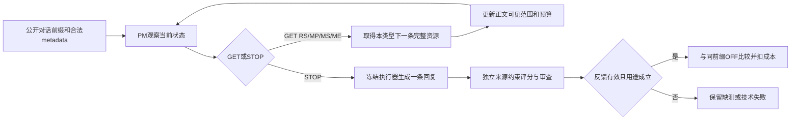

# PM-RL1 研究全景与当前定位

梳理日期：2026-10-22（Asia/Tokyo）。最后核对的研究状态为当日13:28的严格交付收口。本文是研究导航和证据综述，不替代主方案，不产生新的实验许可。研究发生变化时，先更新主方案和当前状态，再更新此综述。

**目前已经形成单轮资源获取环境、来源与角色表示、一次有界执行器适配，以及大量测量诊断；尚未形成合格的自动奖励，真实自然任务的PM强化学习更新仍为0，正式策略比较及独立终评未完成。** 研究的核心问题仍然成立，但不能把工程可运行、生成完成或裁判返回数字当作效果证据。

阅读入口：[唯一主方案](../PM_RL1_FEASIBLE_COMPLETION_PLAN_20260930_ZH.md) · [当前状态](../PM_RL1_CURRENT_STATUS.md) · [阶段时间线](EVIDENCE_TIMELINE_ZH.md) · [目录使用指南](DIRECTORY_GUIDE_ZH.md)。

同日再次核对原始收口、真实运行计数和Git状态后的分析见[研究复核](RESEARCH_REVIEW_ZH.md)。研究进度截止时间未改变；版本核对产生的工程记录与模型实验结果分开保存。

## 1. 研究目的及两层长期目标

方法名是 **Policy Manager（PM）**；`Metacom5_3` 是历史仓库名，不是当前方法名。

最终希望系统既能决定“需要获取什么资源”，又能决定“怎样使用资源形成合适回复”，之后研究这两层的协同。目前PM-RL1只研究第一阶段：执行器经过既有监督适配后冻结，对同一轮回复之前的资源获取策略学习GET/STOP。未来资源使用策略的RL及联合训练尚未设计/执行为本阶段实验。[两阶段路线](../PM_RL1_TWO_STAGE_ROUTE_20261015_ZH.md)

当前主要问题分为：

1. **情境化选择是否有价值？** 相同来源、执行器与预算下，按当前情境选择资源是否优于OFF、固定取量、匹配随机。
2. **读取后继续决策是否有额外价值？** 逐步看到已取得资源正文再决定下一步，是否优于一开始决定整个计划的OneShot。胜过Fixed并不自动证明这一点。
3. **执行器适配提供了什么？** 相同提示和资源下，监督LoRA是否改善使用、澄清或合理不采用，是否只是改善无资源回复。它是配套问题，不能把表示、执行器、策略三项变化合并归功于RL。

原始设计还提出执行器变化后的资源价值和PM迁移问题；当前可行方案已将第二套PM、交叉迁移后移。没有研究未来用户模拟、长期心理疗效或真实人群心理状态转移。[原始方案](../PM_RL1_ORIGINAL_IMPLEMENTATION_PLAN_20260928_ZH.md) · [现行主方案第1、3节](../PM_RL1_FEASIBLE_COMPLETION_PLAN_20260930_ZH.md)

## 2. 与旧项目的关系

| 项目层次 | 方法与证据 | 当前怎样使用 |
|---|---|---|
| 旧PM v1及审稿补充 | `chensiyu78120818`主库及table3、camera-ready工作树 | 独立历史成果；不是PM-RL1的已完成实验 |
| Paper-1 | RS/MP/MS/ME四个L2逻辑回归收益头；其他可选资源OFF的一阶对照；官方ESC-Eval/ES-MemEval指标 | 保留来源、实现、结果身份和outcome locks；正式四头训练不能从旧checkpoint名称推断完成 |
| 当前PM-RL1 | 单轮内五种动作、至多四次GET、允许跨类型组合和动态数量、终局回复效用与资源成本 | 独立`rl1`代码和`outputs/pm_rl1`产物；正式自然任务学习尚未完成 |

“四头”在PM-RL1讨论中表示四类资源，不能误解为必须继续采用Paper-1的四个独立二元分类器。旧Paper-1将顺序/RL写为未来工作，不否定后来已经明确建立的PM-RL1后继方向。[仓库约束](../../../AGENTS.md)

## 3. 数据、资源与可见信息

| 项目 | 现有定义与规模 | 解释边界 |
|---|---|---|
| 来源 | ESConv训练集供策略资源；公开ES-MemEval/EvoEmo供历史记忆与自然前缀 | 公开构造人物，不是18名真实受试者；不使用本项目废弃的自造纵向语料 |
| 记忆来源普查 | 18个owner、401个session，其中85个ESConv seed、316个扩展session | 来源重叠、虚构人物与历史暴露均须披露 |
| 原历史资源 | MP 713条、ME 1,523条；最终profile slots 388 | 不能用最终profile状态倒灌过去切点；数量不是正确性或收益认证 |
| 冻结切分 | train/dev/test为96/18/48前缀；owner为12/3/3 | 原始24 dev是设计上限，实际冻结18；每个前缀与同源事实必须分组 |
| 测试暴露 | 48个test中的32个完整当前会话曾出现在旧完整历史审阅中 | “未用于新参数拟合”不等于研究全过程从未见过；封存人评24对是另一套用途，不能混称 |
| RS | 固定排序的策略参考/动作提示 | 参考中的具体情境与第一人称经历不能自动成为用户或当前AI的事实 |
| MP | 切点时的profile视图；稳定事实槽及来源/时间状态 | 抽取/重提时间不等于事实被重新确认，临时状态不直接升级为稳定事实 |
| MS | 同一owner、严格过去的一整段原始session | 不是摘要；不静默截断或用当前句补位 |
| ME | 严格过去的原子事件/经历及时间、行动阶段、依据 | 建议、意向、尝试、完成、有效必须区分；行动—已观察结果很少，不能声称学到个人疗效 |

来源：[数据诊断](../PM_RL1_DATASET_DIAGNOSTICS_AND_RESEARCH_PATH_20260930_ZH.md) · [实际冻结](../reviews/20260930/pm_rl1/source_and_capacity_20260928_v1/dataset_freeze.json) · [来源普查](../reviews/20260930/pm_rl1/dataset_diagnostics_20260930_v1/census.json)。本轮核对这些既有摘要，没有重新读取封存答案或废弃数据正文。

actor与critic使用相同白名单Observation：当前公开对话、已GET正文、数量、剩余预算、冻结候选metadata、动作mask和初始可达计划mask。未取得正文、gold、未来、owner ID、审查意见和奖励分数不可进入策略网络。候选metadata本身仍可能提供间接信息，不能把初态说成“完全没有候选信息”。[schema.py](../../src/metacom_pm/rl1/schema.py) · [env.py](../../src/metacom_pm/rl1/env.py)

## 4. 环境、方法与反馈



- 动作是`STOP/GET_RS/GET_MP/GET_MS/GET_ME`，总GET≤4；不是每头各运行四次。每次只取本头排名下一条，不重新检索，不跳过过大rank1，不撤销已取得资源。
- 四类计数总和≤4，理论最多70个终值计划；实际还要检查库存、完整渲染token和逐步可达性。不同GET顺序不会制造不同终局资源处理。
- 资源预算2,048个Generator tokens，包含包装、元数据和分隔符；这不是回复长度上限。回复采用自然EOS/EOT，技术超时与质量零分分开。
- GET是程序化信息获取，不调用LLM模拟新世界或用户反馈。STOP后才调用冻结执行器，并绑定真正的生成/评分记录。
- 基础执行器是Llama-3.1-8B-Instruct；P2主执行器是选中的第三epoch LoRA。BGE-M3检索固定。实际模型、adapter、renderer、提示、draw与缓存身份均单独绑定。

现有候选反馈量表为`q∈{0,1,2,3,4}`、`m∈{0,0.25,1}`，效用`U=q/4−m`；成本为完整资源tokens占2,048预算的0.05倍。总回报定义：

```text
R = U(资源回复) − U(同前缀OFF回复) − 0.05 × 资源tokens / 2048
```

这是当前任务的内部代理量表，不是官方ESC-Eval成绩。来源、主体或严重度尚未确定时不能补零，结构有效也不等于语义正确。所有同前缀比较复用绑定的真实OFF，不人为添加有利基线。最近的“评分关联审查”意在区分回复有缺陷与初评漏掉缺陷，避免已经计入的缺陷再触发重复补核；目前仍属未合格候选。[主方案第8节](../PM_RL1_FEASIBLE_COMPLETION_PLAN_20260930_ZH.md) · [评分关联实现](../../src/metacom_pm/rl1/feedback_score_audit.py)

## 5. 方案、实际进度和已有结果

| 阶段 | 实际进度 | 已有结果及限制 |
|---|---|---|
| 环境/E0 | 已完成工程验证 | GET/STOP、观测隔离、可重放、缓存与有限环境PPO；E0不能替代自然支持任务学习 |
| P0 基线 | 已完成 | 研究基线、来源、预算口径及模型身份核对 |
| P1 表示/来源 | 已完成有限范围 | 72条MP＋24条ME核查；72条原定诊断＋16条接口修复；新版114个train/dev前缀的6,899个可达计划；未声称全来源无误 |
| P2 执行器 | 已完成且有披露缺陷 | 493条弱目标（413 train、80 dev），一次三epoch LoRA、78次优化器更新，选epoch3；586条主回复＋53条base对照全部自然结束 |
| P3 测量/人评 | 已有多轮开发，奖励仍未合格 | 开发人工信息已收到；本地及API候选、分步核查、重复噪声、关系/任务参照、自动审查均有实测；不能再写成“尚未收到任何真人标签” |
| P4 BC/自然任务策略学习 | 未完成 | 自然任务参数更新0；32随机初始化轨迹准备不能代替BC起点、完整PPO及正式基线 |
| P5 独立评价 | 未执行完成 | 保留冻结后评价与最终48对人评设计；独立性不能由同裁判重复评分代替 |
| P6/P7 主表与论文 | 待正式证据 | 已有工程、数据、测量结果可写，但自然任务RL主结论尚无证据 |

P1、P2具体来源：[P1结果](../PM_RL1_P1_REPRESENTATION_RESULTS_20261001_ZH.md) · [P2结果](../PM_RL1_P2_EXECUTOR_RESULTS_20261001_ZH.md) · [P2机器记录](../pm_rl1_completion_20260930_v2/p2_results.json)。

P2的dev回复NLL由1.786513降至epoch3的1.117342，仅表示对弱目标分布的拟合。4条已训练目标存在重复JSON键准入缺陷（train3、dev1）；原数据、权重和结果保留，不能事后改成训练489条。6组跨加载重复输入中只有2组输出逐字一致。未检出严重错误、自然结束、覆盖广或NLL降低，都不能单独证明支持质量提高。[P2复现补充](../pm_rl1_completion_20260930_v2/p2_replay_addendum.json)

人评来源必须分开：10月14日开发16题含15项明确偏好和1项无法判断，Du为派生记录，不能当两套独立人评；10月19日八条单回复标注及后续澄清、10月20日七组方向判断均来自同一研究者。七组中新6平局、1明确方向；旧P04偏好另行复用，不能称第八组新盲评。当前自动裁判并没有因此获得奖励资格。[开发结案](../PM_RL1_DEVELOPMENT_CLOSEOUT_20261014_ZH.md) · [人评原件入口](/home/tokkio/PM-RL1/04_人评原件)

## 6. 最近的实测到底说明了什么

时间线和逐批证据见[完整阶段索引](EVIDENCE_TIMELINE_ZH.md)。主要结论如下：

- **RS可适用性有一项局部正结果。** 16次新旧提示生成修复了已知的无依据求职情境套用。追加41次生成没有确认更多同类“旧错→新对”，且仍存在历史支持者话语被当前AI认领的问题。不能推出总体资源增益。
- **拆成两步不自动改善事实核查。** 24次配对诊断没有证实至少两个情境的修复；行动提醒的同一输入两次仍从“无行动预设”翻成“有行动预设”，U差0.5。
- **多评平均不自动提供更可靠奖励。** 48次重复测量、七组人类方向参照没有支持全量双评平均；主要问题包括事实关系、当前任务要求和歧义/严重度到数值的映射。
- **人工辅助关系能修复一个案例，但不是自动系统资格。** 28次关系参照A/B中，06B具体行动关系得到局部修复；q仍可从2到3，仅此即可改变扣成本后的收益符号。
- **额外任务卡未显示增益。** 32次共享任务参照A/B中，同期A也已稳定，因此不能将两臂共同表现归于B；04B双读与35B严重度仍存在差异。
- **反馈审查存在两个不同层次的缺口。** 第一轮因本地要求`evidence`、模型可见合同不完整而失败；统一`source_evidence`后新增11次机械有效。此后评分关联审查在普通JSON和Beta strict工具参数下仍分别出现末尾多余括号，且有效输出有q3条款复述矛盾。格式失败和语义失败分别记录，不能用修掉字符重写历史成功率。

这些结果把问题缩小了：来源事实核查、数值后果一致性、实际序列化交付可靠性尚未同时成立；不是缺少更多PPO运行次数。开发例反复使用，不能把熟题改进当独立泛化。

## 7. 最新状态和费用口径

截至严格交付收口，当前裁判试验计数为**307次评分/审查尝试，容量374**；这不是全项目所有生成/核验调用总量，也不是307个独立案例。最后原8槽共5次尝试，3有效、2技术失败、3未派发，没有完整有效重复组。自然任务RL更新0，阶段已关闭。[当前状态](../PM_RL1_CURRENT_STATUS.md)

| 账目 | 已记录数值（USD） | 含义 |
|---|---:|---|
| 最后strict接续新增 | 0.0613974 | 新增3次保守记账 |
| 同阶段含旧两次 | 0.1162971 | 同阶段累计，不是两笔新的额度 |
| API试验/共享后续累计 | 1.9058232 | 两者当前数值相同，不能相加 |
| 含历史边界的总账 | 3.41306611 | 历史边界1.50724291＋后续累计 |
| 已知未结责任 | 0 | 最近收口记录值；本轮未向平台查账 |
| 共享后续硬上限 | 20 | 剩余额度不是完整研究已有可行报价或自动执行许可 |

以上是本地保守记账，非本轮核销的服务商账单。现有完整研究费用场景尚未在$20内落实；不能以最后批次较便宜推断全部PPO、基线和独立评价都能负担。[原始费用记录](../../outputs/pm_rl1/judge_selection_preparation_20261014_v1/score_audit_strict_results_20261022_v1/VALIDATION_AND_COST.json)

## 8. 保留的正式比较和完成边界

正式方法仍包括OFF、Fixed-Dev、Matched-Random、OneShot、BC-init、BC-union、PPO、独立训练PPO-NoText；种子17/29/43。128或384 episodes/seed尚未作当前正式运行选择，须按预定吞吐和用途冻结，不能按效果选规模。

BC-init必须是实际PPO起点；BC-union与OneShot可使用共同训练反馈union，但要披露相对在线PPO的信息取得时序差异。OneShot看同一初始信息并覆盖最多70个合法终值，不能做成五个弱选项。NoText从初始化到训练/评价均屏蔽已取正文，不是在测试时临时关闭FullText编码。

完成判断依赖真实训练、公平比较和独立效果约束：胜Fixed但不胜OneShot只能支持情境化规划；胜BC-init不胜BC-union不能排除更多监督数据解释；自动奖励变好但人评不支持必须收缩效果主张；负结果也可以是完整研究，未运行不能写成负结果。[主方案第9—10节](../PM_RL1_FEASIBLE_COMPLETION_PLAN_20260930_ZH.md)

## 9. 接续时应优先处理的事项

以下是本轮基于现有证据的梳理判断，不是擅自改方案或启动下一批：

1. 集中决定实际交付失败的处理版本，并核对评分审查是否忠实使用原量表。当前证据已不支持仅靠`strict=true`承诺可靠。
2. 为有限用途反馈明确何时可形成数值、何时保留解释歧义或缺测；保持回复缺陷、已计入缺陷与真正漏判分开。
3. 同步核算完整训练、基线、恢复和独立评价的请求与费用，处理共享$20与现有场景估算之间的缺口，不静默删对照。
4. 在反馈用途成立后落实真实BC-init和三种子策略实验；正式终评前冻结方法和统计，不用开发熟题继续替代独立验证。

日常整理、来源索引和已有授权内的工程可以继续；本轮实际工作仅完成资料掌握、目录归档和导航修复，没有新增模型调用、改分或训练。

## 10. 本次掌握的覆盖与限度

核对了原始设计、现行主方案/状态、结构化阶段结果、主要人评来源说明、10月14—22日关键诊断报告，以及环境、观测和反馈相关代码。建立全仓库允许范围内的逐文件元数据清单，逐字节验证本次归档文件。

这不是逐行证明全仓代码正确，也不是重跑实验或独立重标每份回复。未重新解封验收标签，未读取密钥正文，未改动其他用户目录，未使用废弃自造数据。存在于磁盘的脚本、checkpoint和历史结果，一律按来源/阶段解释，不能按文件名直接认定当前研究完成。
