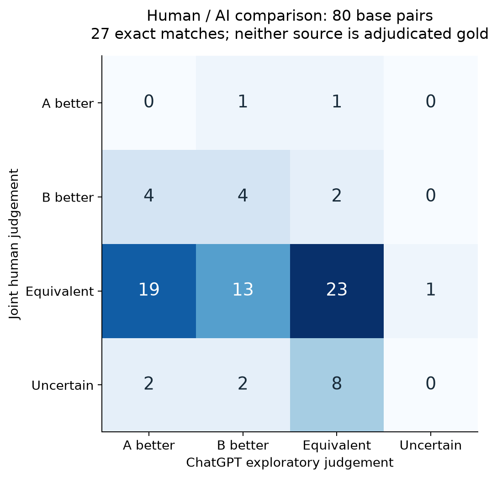
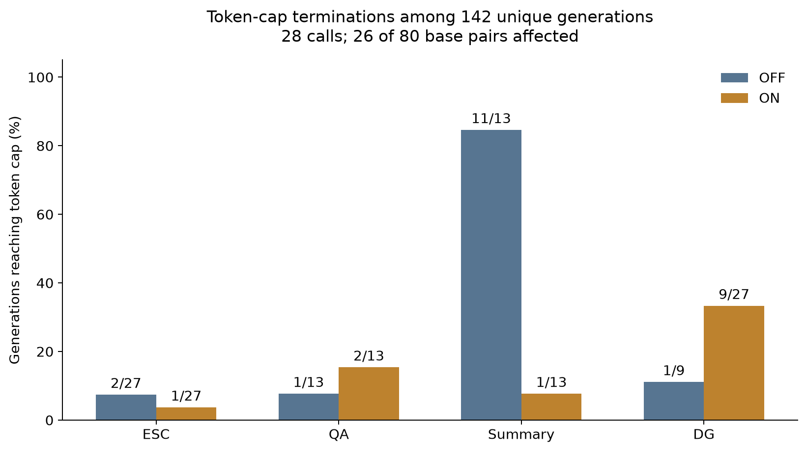

# Metacom5_3：已完成人评与 ChatGPT 评审分析

日期：2026-09-17。对象：你们共同完成的 A 卷、ChatGPT 完成的 B 卷。研究代码基线：`f1d96b3e457991233384767fdd3101db059a495e`。

**这两份结果有用，应该完整保留，不需要因为本次问题重新生成试卷。但它们目前不能直接作为“已完成双独立人评、裁判已合格”的证据。** 本次最重要的发现，是实际中文材料存在翻译错误、部分判断混用了情绪支持与事实问答的标准，以及原始生成确有大量触及长度上限。应先收口这些问题，再决定正式参照的使用方式。

本次完成：两份提交的严格结构检查、全部 192 条理由阅读、96 个呈现的身份对齐、80 个基础配对统计、16 组反序检查、142 条生成缓存追溯、18 个重点呈现的原文证据复核，以及中文材料的重点抽核。这里没有重新给全部 80 对做独立裁决；重点案例也没有覆盖所有翻译错误。AI 的事实判断经过部分原文抽核，不被整体视作正确答案。

## 1. 文件可靠性与来源

| 检查 | A：联合人类记录 | B：探索性 ChatGPT 记录 |
|---|---:|---:|
| 有效 verdict + 非空理由 | 96/96 | 96/96 |
| 与对应 V2 空白卷相比，非评分字段保持一致 | 是 | 是 |
| 题序、题干、回复、参考材料保持一致 | 是 | 是 |
| 独立人类主评来源已经建立 | 否 | 否，明确是 AI |

A/B 卷本来就是同样的 96 个呈现、分别打乱顺序；同一个 presentation_id 的左右回复方向也相同。让两个人评不同题，反而不能直接测同题判断一致性。本次按 presentation_id 对齐，没有拿“第 1 题”对“第 1 题”。80 个基础配对之外的 16 个反序不是新的独立任务。

B HTML 的 `ai_review_metadata` 明确写了 `is_human_rater=false`。提取后的 JSON 虽保留原始 `RATER_B` 模板字段，但本目录文件名与来源说明始终将它标为 AI；不能仅凭通过格式检查就导入为第二个人类主评。

目前按你描述的“两人一起做 A”记作一份联合人类判断。讨论后一致不等于两份独立判断的一致率。如果确有分别完成、尚未交流时的独立记录，可另行保留并分析；没有记录则不能事后重建。A 文件中的旧状态 `READY_FOR_INDEPENDENT_RATING` 是保留的模板字段，不是评审独立完成的证明。

仍待补充的来源信息：A 实际主要阅读英文还是中文、中文显示版本是否与 B HTML 相同；ChatGPT 的模型/版本、输入方式、是否接触过 A 答案。本报告没有擅自填补这些信息。

原件已复制到本目录 `originals/`，未修改源文件。SHA-256：

- A：`0272f503c61811484c9b7da2c6bb25e331538376bd0e1b683e4f2dd3c6e5a94b`
- B HTML：`d956751629e08d11511dd5efa7b1060ab5957796e5f6012b214ac0e1b6ad6c92`

## 2. 实际判断分布

下表只使用 80 个基础配对的原始非反序呈现。“A 更好/B 更好”是候选回复的左右方向，不是人类与 AI 的身份，也不是 ON/OFF。

| 判定 | 联合人类 A | ChatGPT B |
|---|---:|---:|
| 候选 A 更好 | 2 | 25 |
| 候选 B 更好 | 10 | 20 |
| equivalent：实质相当 | 56 | 34 |
| uncertain：无法可靠判断 | 12 | 1 |
| 合计 | 80 | 80 |

完全一致 **27/80 = 33.75%**。包括反序时是 33/96，不能把两种分母混用。此处是“联合人类记录与一个探索性 AI 的一致程度”，不是 AI 准确率，更不是人类之间的一致率。

| 任务 | 基础配对 | 人类相当 | AI 相当 | 完全一致 |
|---|---:|---:|---:|---:|
| ESC：情绪支持 | 27 | 25 | 19 | 17/27 |
| QA：事实问答 | 13 | 1 | 8 | 3/13 |
| Summary：摘要回答 | 13 | 6 | 3 | 2/13 |
| DG：含记忆的对话回复 | 27 | 24 | 4 | 5/27 |

人类判相当的 56 对中，AI 有 23 对也判相当、32 对选出胜者、1 对 uncertain。这说明两边使用“实质优势”的尺度可能不同，也可能有事实核验和任务理解差异，不能只归因于 AI 太爱分胜负。在已核查案例中，两种情形都存在。

若机械地总判 equivalent，也能与当前人类记录一致 56/80；因此不能只按总体一致率选裁判。应同时看事实错误、任务完成度、各类别支持数、相当识别和稳定性。当前人类参照本身尚未裁决，不把这些描述性统计包装成 qualification 成绩。

反序一致性：人类 **15/16**，AI **16/16**。人类唯一不一致是 A78 与 A13：原序 uncertain，交换左右后选 A 更好。原评分不改，后续解释另记。这表明多数差异不是简单的左右位置随意选择，但一致性高也不能证明判断正确；例如对“有生成文字就比拒答好”的稳定偏好仍可能稳定地偏离事实标准。AI 是否一次看到全卷、识别到重复题尚未确认，其 16/16 也不能证明独立逐题稳定性。

DG 27 个基础配对共享 9 个情境；memory 还存在同一 owner 依赖。本报告不对这批数据做独立同分布的显著性检验或窄置信区间。

## 3. 你提出的偏好问题成立，但有适用边界

你在 A95 写“我更喜欢 A，我同学喜欢 B”，最终仍判 equivalent，是很有用的记录：个人喜欢哪种表达，与是否存在任务上的明确优势，可以分开。在当前需求不明确、两种回复都合理时，不必强行判胜者。

**当前 MP 确实是 Current Profile View：稳定、在目标时点有效的个人事实；不包含 response-preference history。** 冻结研究方案明确把 `MP_PREFERENCE` 移出 Paper 1；当前规则也禁止把偏好元数据作为 PM 特征。爱好、职业、家庭等 profile 信息，不等于“喜欢长回复、先倾听还是先建议”的回应偏好。不能根据职业、性别或你自己的喜好推断题中用户的风格偏好。

你记得历史上区分 profile/preference 的方向没错。现有文件能确认最终排除了 preference 分支，并采用公共数据限定的研究范围；本次未找到足以把历史决定唯一归结为“ES-MemEval 完全没有任何偏好信息”的记录，因此不作这个更强断言。

真实部署中，明确的回复偏好可能有用；如果当前可见对话明确说“只想倾诉，不要建议”，这本来就是判断适切性的证据，不需要先恢复 MP_PREFERENCE。建立跨会话偏好模块则属于后续研究扩展，不能用这批人评直接宣称它已有效。

偏好不能抹平事实差异。例如 A26 的原文是大学聚会和曾闹翻的朋友；候选 B 改成高中聚会、担心见到前任。这不是两种同样正确的表达风格。A6 的考试失败焦虑也不能被改成近期工作晋升压力。相反，A95 两种沟通策略的风格分歧可以保留，不应为迎合 AI 而改判。

## 4. 一部分分歧来自任务口径，需要澄清而不是全部重做

**QA 和 Summary 评的是是否正确回答给定问题，不是回复是否像一位温柔的咨询者，也不是哪段摘要将来更适合注入模型。** 当前 MS 存的是完整过去原始会话，不是这些生成摘要。这批 Summary 是被评测的任务输出。

参考答案给评审看，不直接给 Generator 或 PM。OFF 本来可能拿不到回答所需的可选记忆；不能因为卷中有参考答案就推断生成器也见过它。题目用第三人称、询问他人的经历，是 benchmark 回忆任务的形式，并不自动意味着实际部署中的越权索取个人聊天记录。

| A 卷题号 | 已核查到的关键点 | 对判断的影响 |
|---|---|---|
| 11 | 参考结局是分手；候选 A 写关系改善并同居 | “做了总结”不等于正确总结 |
| 27 | 参考与候选 B 都是搬到 California | 一句直接事实答案可以完整完成 QA |
| 12 | 参考“两年多没与父亲说话”，两边都拒答 | 多几句任务说明不能代替回答事实 |
| 49 / 81 | 同一配对；参考是 Unknown，一方编出联系 HR 的日期和已解决 | 不能因为答案更长、看似努力就奖励无依据细节 |
| 64 | 两个回复逐字相同，且都差 | 按既定口径应区分“同样差”与“无从判断” |
| 38 / 48 / 62 / 76 | 理由讨论“哪种形式对模型有用” | 应回到摘要的忠实性、事件覆盖、时序与因果 |
| 8 / 9 | 理由不确定完整历史是否可用 | V2 明确允许完整过去历史，摘录不穷尽证据 |
| 78 / 13 | 唯一一组人类反序不一致 | 单独澄清，不能覆盖原始记录 |

equivalent 可以是两者同样好，也可以是两者同样差。uncertain 用于证据不足、正确性无法确定，或实质利弊无法权衡；不是“我不满意两边”的代称。简短 unknown 在参考本身未知时可以是合适弃答；当然，错误拒答和无根据断言都可以是缺陷，不能把所有拒答自动定为胜者。

AI 的 96 条理由确实有分析价值，多个事实提醒与原文吻合；但 AI 仍有需权衡之处。例如 A8 对应的 B 回复谈与妹妹重联，虽然历史确有其事，却未必回答当前大学聚会问题。A89 对应的 AI 判断重视输出中的支持作用概括，同时容忍未经参考支持的日期和过程，净优势也应另行审查。不能因 AI 提供了日期和长理由就直接当作 gold。

这些问题也说明材料说明和任务切换没有充分帮助评审建立共同理解，不能全部归咎于填写者。现有逐题理由恰好使这些偏差可以追溯，避免让它们悄悄进入裁判校准。

## 5. 中文页面存在已确认的实质翻译错误

现存 `AI_B_中文评审结果.html` 的历史翻译元数据写明：`local NLLB-200-distilled-600M; machine translation with selected corrections; not fully human reviewed`。

同一份 2025-11-05 历史中：

| 英文原文 | HTML 中文译文 | 问题 |
|---|---|---|
| She's been asking for a pet | 她一直在要求一只猫 | 擅自指定物种 |
| having a pet … for your family | 拥有一只狗狗…对你的家庭 | 同样擅自指定，且前后不一致 |

你在 A3 的理由恰好写“提到的是艾米莉想要一只猫”。如果 A 使用同版译文，这就是可能的解释；目前只有 B HTML 在手，不能把关联写成已证明的因果。英文里的 pet 没有说明是猫，也没有说明是狗。该题选 B 的方向仍可能成立，因为候选 A 本身也未经依据指定了狗；所以发现译文问题不意味着自动翻转原评分。

两份 JSON 的英文内容通过身份检查，与“实际读到的中文是否忠实”是两件事。原先空白 V2 的技术验证不能替后加的中文内容担保。后续需要记录实际人机证据语言；不要一边主要看有误的译文、一边看英文，然后把差异全部归给裁判能力。本次保留了两处明确错误证据，未声称全量中文翻译已通过审核。

## 6. 截断是真实生成现象，还存在示例复述和无故拒答

生成缓存显示 **28/142** 条唯一生成触及长度上限，涉及 **26/80** 个基础配对；包括反序呈现时会看到 35/96 题受影响，不能重复算成 35 个基础样本。

| 任务 | OFF 触限/唯一生成 | ON 触限/唯一生成 |
|---|---:|---:|
| ESC | 2/27 | 1/27 |
| QA | 1/13 | 2/13 |
| Summary | 11/13 | 1/13 |
| DG | 1/9 | 9/27 |

QA/Summary 本批上限为 256 tokens，触限记录的 completion_tokens 也为 256。Summary 的 OFF 回复 11/13 带有 `## Step` 式分步过程，ON 为 1/13；这些过程占用了输出空间。触限标记与肉眼看到半句话截断并非完全等价，DG 还可能经过完整句子前缀处理。本次所有展示回复都与缓存的 accepted_text 一致，所以至少这些截断不是导出 JSON 丢尾巴造成的。

还有明确的示例污染：A45/A78 中的 Nick 学物理、逃课、转专业内容来自系统提示的输入格式示例；A65/A73 等 QA 回复里出现的 Sarah 生日材料也存在于系统提示。这不是实际用户对应的记忆证据。按保守的精确短语匹配，QA OFF 至少 3/13、Summary OFF 至少 2/13 明确复述了示例；该数字只是精确匹配下界，不是全量语义错误率。

系统提示中的示例与 256-token 设置已属于当前实现。当前证据支持“示例被混作记忆、过程占用长度”的具体诊断；还没有通过对照实验证明改变哪一处能解决多少问题。也不能把所有拒答都解释为截断。

处理建议是：保留原回复和原评分，把触限、示例复述、错误拒答分别记录。在进入正式大规模生成前做离线提示与官方兼容性核查。若决定改模板、输出上限或后处理，需要版本化并明确重跑范围；不能只给 OFF 加长度、只补写坏例，或偷偷用修复后的回复替换已评样本。若保留冻结设置，正式结论应限定于该生成设置，并透明报告这些失败。

## 7. 这些劳动怎样保留下来，后续怎样最少重复

现有成果可以立即保留为：

1. 一份完成的联合人类审阅记录，含 96 个原始判断与理由，以及 15/16 的反序稳定性诊断。
2. 一份明确标识为 AI 的探索性对照，含 96 个模型判断；可分析事实核验和分胜负尺度，但不是第二个人类。
3. 一组可复用的错误案例和原始生成诊断：翻译、任务理解、unknown、同样差、示例复述、截断、时间和人物错置。
4. 在补充来源信息并形成单独裁决记录之后，用于开发和审查自动裁判的候选参考；不能直接变成 PM 正式训练标签。

**当前不建议让你马上再做一整套 96 题，也不建议重生成卷子。** 优先处理材料和口径，原卷完整保留。已有较合理的风格相当判断可以留下；明确的事实和翻译问题用证据卡逐项解释。若以后需要你确认，应基于已定位的问题、单独记录理由，不让你重新从零读全部历史。模型辅助查证后的澄清要如实标为“看过 AI 后的复核”，不能回填成从未受提示的独立主评。

不过，“完全不再增加独立人评”与“仍声称完成原定双独立人评”不能同时保证。少量挑出的难题澄清，能够修正开发参照，不能补出全卷独立人类一致性；按 AI 分歧挑选的子集也不能估计总体一致率。

当前合同仍是 2026-09-08 V2 的两名独立人类各 96 题。本次没有修改它。以下只是供研究者选择的方案：

**PROPOSED RESEARCH CHANGE — NOT AUTHORIZED**

| 方案 | 修改什么 | 保留与损失 | 后续工作 |
|---|---|---|---|
| 优先节省重复劳动：联合人类开发参照 + AI 探索对照 | 修改双独立主评及相应一致性报告要求，明确语言材料与事后澄清方式 | 保留全部原始劳动；不能声称双独立人评或未经模型影响的 gold。已有正式结果为零，无正式模型需作废 | 先补来源、修正重点译文证据、单列裁决；评价自动裁判时明确参照局限，必要时设置独立保留核验，不能在同卷反复调到一致 |
| 保留原定双独立证据强度 | 保留独立人类要求；如无原始独立记录，需如实记录这次偏离并定义补充方案 | 联合 A 仍保留；AI B 不可顶替人类。事后新增评审也不能描述成原先两人已独立完成 | 找未接触答案的独立人类使用经核实材料；若需完整双独立 reference，必须保证每个目标判断确有两份符合条件的独立记录，不能预先承诺只补一份就足够 |

这不是要求现在审批或立刻增加工作量；它说明为什么目前不能自动标记“资格审查完成”。主张的实质仍应由后续正式官方评测支持，人评方法的证据强度则必须按实际过程报告。这里没有提出任意准确率 PASS 门槛。

正式推进顺序仍为：收口材料与参照来源/使用方案 → 单独授权的 teacher qualification → 真正的 RS/MP/ME/MS amount/top-k calibration → 冻结各头 k* 与容量 → 正式 effect labels 和 PM training → 官方指标验证。当前卷里的 k∈{1,2,4} 不能替代最终 top-k 结论。Summary effect 编码中此前发现的 equivalent 冲突也应在正式标签生成前修正，不能由本次人评掩盖。

## 8. 交付与复现

- `分析报告.html`：可直接打开的报告，图片内嵌，便于从远程资源管理器下载。
- `逐题对照.csv`：96 行，保留两份理由、A/B 题号、任务、反序标记与生成触限字段；含研究者映射，别发给未来盲评人。
- `全部理由对照.txt`：便于阅读两边的全部理由。
- `重点案例证据.json`：18 个重点呈现的原文与核查说明；仅分析，不是改判。
- `translation_findings.json`：已确认的两处翻译错误与显示版本局限。
- `summary.json` / `reverse_consistency.json`：机器可读统计与逐组反序结果。
- `可复现分析.ipynb` / `可复现分析.html`：已经从头执行的分析笔记本与静态预览。
- `analyze_ratings.py`：严格 JSON、原题身份、题号对齐与生成缓存追溯脚本；调用项目已有评分结构校验器。
- `originals/`：提交原件快照。

本次未修改仓库、未推送评分、未调用付费模型、未进行 Gemini qualification、正式 effect 或 PM training。所有分析放在 `~/人评结果分析_20260917/`。

### 依据

- [原始联合人类 A](/home/tokkio/paper1_pairwise_teacher_rater_a_sheet_v2_zh_v1_rated.json) 与 [AI B HTML](/home/tokkio/AI_B_中文评审结果.html)。
- [V2 人评修订，尤其证据范围与独立主评要求](/opt/tokkio-data0/tokkio_projects/Metacom5_3/project/docs/PM_PAPER1_HUMAN_REFERENCE_V2_AMENDMENT_20260908_ZH.md:13)。
- [当前人评 instrument](/opt/tokkio-data0/tokkio_projects/Metacom5_3/project/data/paper1_authority/paper1_pairwise_teacher_human_instrument_20260908_v2.json)。
- [冻结方案：MP_PREFERENCE 退出 Paper 1](/opt/tokkio-data0/tokkio_projects/Metacom5_3/project/docs/PM_FINAL_FROZEN_RESEARCH_PROGRAM_20260816_ZH.md:93) 与 [当前 MP 定义](/opt/tokkio-data0/tokkio_projects/Metacom5_3/AGENTS.md:121)。
- [RQ2 提示和示例](/opt/tokkio-data0/tokkio_projects/Metacom5_3/project/src/metacom_pm/paper1/execution/rq2_prompts.py:37)。
- 生成追溯：`project/data/paper1_authority/paper1_pairwise_teacher_local_generation_result_20260904_v1.json` 及其指向的 142 条缓存；盲键和呈现计划按 manifest 对齐。具体来源路径与哈希在 `summary.json`。
