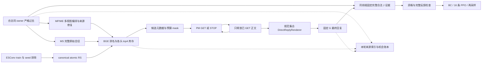

# PM-RL1 有界重整：首个离线工作包

日期：2026-10-29。基线：`a81e6ad286abe60fec8494d89199c15d9e4a82a9`，本地与本轮查询的 PR #3 HEAD 一致，开始时工作区干净；PR 保持 draft。本轮名称使用 `R20261029.P0/P1/P2/P3-min`，不重编号或覆盖 9 月主方案的 P0–P7。

**已完成身份核对、114 个 train/dev 前缀的机械机会审计、586 条原回复及 53 组执行器对照的绑定复算、22 条 J1 初评请求的离线重建，以及不接入主环境的来源索引最小实现。没有取得新的合格奖励或学习结果。** 本轮真实模型加载、推理、评分、训练、人评派发和 API 花费均为 0；只使用本地 tokenizer 计数。

机器统计见 [PROFILE.json](PROFILE.json)，命令和复算方式见 [RUNBOOK_ZH.md](RUNBOOK_ZH.md)，旁路示例见 [SYNTHETIC_INDEX.json](SYNTHETIC_INDEX.json)。完整私人记录在 `project/outputs/pm_rl1/reorganization_20261029_v4/`；原文不复制到公开报告。

## A. 对网页版与 dot 的核对，以及保留和差异

已完整阅读本轮附件 562 行、用户粘贴的执行指令及 dot 补充；核对当前主方案、状态、10 月 23 日诊断/真实集成结果、执行合同、measurement freeze、预算和实际代码。dot 对首轮权限、排序合同、因果归因和资格适用范围的补充成立，采用其后置补充解决冲突：首轮包含 P3-min，但不包含新的语义抽取、主资源升级或真实模型试验。

| 事项 | 本轮处理 |
|---|---|
| RQ1 选择性资源配置；RQ2 读后继续决策 | 保留；EvoEmo 后续历史不作为当前回复造成的情绪变化 |
| STOP/RS/MP/MS/ME、GET≤4、70 数量计划、2048 tokens | 保留。70 是候选计划域，不是每前缀 70 个可达计划 |
| MP target-time view；ME 全历史经历；MS 完整严格过去；RS 原子支持动作 | 保留。旧 378/1411/80 不与多视图统计混算；事件结果未知不等于事件无价值 |
| q/m、U=q/4−m、成本系数 0.05、真 OFF | 保留；没有为了让成本影响更明显而改权重 |
| 三 seed、统一 128/384、强固定/随机/OneShot/BC/NoText | 保留；没有以工程测试、单头诊断替代正式比较 |
| 已存在的来源绑定、atomic RS、来源排除、DirectReplyRenderer、内容评分缓存与恢复 | 验证并复用；不当作本轮新建能力 |
| 本轮新增 | 独立机会审计模块、来源索引模块、离线入口、合成测试、逐条账本与本报告 |
| 排名、呈现和 actor 输入 | 主版本未改；旁路检索分数明确不是 BGE similarity，结果仅在构造/评价域 |
| 旧失败、预算、合同、人评原件 | 保留，保护文件前后 hash 一致；首个审计失败也保留 |

需要纠正或限定的解释有以下几处。

1. **“反馈是工程瓶颈”只说对了一部分。** 漏发量表、JSON、队列恢复是工程问题；同一依据支持两种阅读，或事实理解一致但严重度不同，是测量定义/执行能力问题。修好传输不能代替后两项。反过来，旧格式失败也不能证明模型缺乏支持质量判断能力。
2. **“增加图谱就能纠正裁判”尚无证据。** 已有 06B 参照诊断中，关系判断改善后 q 仍出现 2/3。这说明“事实读懂了”和“应扣到哪一档”不是同一个任务。来源索引能帮助第一项；第二项仍需固定量表执行和独立参照。该观察是局部诊断，不是图谱无效的证明。
3. **当前并非完全没有资源组织。** MP/ME 已有来源跨度、角色、报告时间及未知字段，RS 已接 canonical atomic treatments，源重叠排除也已实现。新增价值应是查询、关系与呈现的可检验改善，不是再造一套文件格式。
4. **“MS 太长”应具体到阻塞方式。** 本轮全部 425 个 MS 候选单独呈现都未超过资源预算，但其中 179 个因前序资源累积而不可达。例如第 0 个 train 前缀的 MS rank 3，假设单独呈现为 951 tokens；按现行规则必须先取 rank 1、2，累计为 2152，超过 2048。不能据此宣布 rank 1、2 无关，也不能直接改成免费跳到 rank 3。
5. **有引文不等于编译正确；没引用不等于没理解。** 示意例（非新增数据标签）：原文“我打算和母亲谈谈”可准确定位，但若编译成“已经谈过且关系改善”，引用位置再准确也不支持这个结论。回复未复述该句，可能是合理忽略，也可能是未利用；没有匹配证据不能二选一。
6. **资源效益还未证明，不等于已有反证。** 既有人工 4 个资源对照是 3 平、1 偏 ME；这个 ME 案例后来被 P04 复用，不能算两票独立正证据。53 组 base/LoRA 同输入材料也不是 53 个已标注金标。不能把较少的行动结果记录解释成 ME 应被改成“成功行动库”。

此前一个月的停滞不能归结为“PPO 学不出来”：真实 BC 检查点和自然更新都是 0。现有记录更支持如下链条：早期来源/角色组织和弱目标有缺陷；部分已修复；裁判迭代同时混入交付故障、阅读歧义和严重度分歧；多次尝试集中在相关熟题，未形成当前流程的完整资格回执；独立参照回收、阶段生产适配和完整预算仍未落实。因此累计 308 次不是 308 个独立失败样本，也不是 308 次不同模型能力的独立检验。

实施责任也需要说清：漏发完整量表/字段合同，以及只检查局部构造却未核对实际请求，是我方代码和验收覆盖的缺口；不能让模型为没有收到的信息负责。原方案已有准入、恢复和失败出口，却未及时把后续局部诊断接回一次可收口的阶段，这是推进组织的问题。改进必须体现为完整链路验收、明确材料/核验责任和有限路线选择，不能再用新增脚本数量作为研究进展的主要指标。

纠正路线不能简化为“只改提示词”，也不能继续依赖提示词循环。历史上还改过来源参照、结构交付、核查/补核和模型候选；但这些并不等于训练出了一个经独立监督验收的纠错器。G 的既有 LoRA 训练与裁判的资格是两件事。后续应针对缺失能力补证据、执行有限选择；同配置无新信息的重跑不计新进展。

## B. 实际四资源数据流与代码路径

下图描述已核对的冻结主链；虚线为本轮旁路，未向 actor 交付。

| 环节 | 真实代码/入口与核对结果 |
|---|---|
| MP/ME | `project/src/metacom_pm/paper1/multi_view_memory/candidate_adapter.py::materialize_multi_view_candidates`；target 截点过滤、MP slot/latest 与冲突、ME 历史单位。`rl1/data.py::as_of_memory` 传切点；`rl1/source_repair.py::repaired_as_of_memory` 在投影后做既定抑制，不自动回退成更早事实 |
| MS | `project/src/metacom_pm/paper1/memory/ms.py` 形成完整原始会话；当前库存和 renderer 未换成摘要 |
| RS | `paper1/rs/strategy_bank.py`，`paper1/rs_atomic_move/catalog.py`、`canonicalization.py`、`renderer.py`；`project/scripts/rl1/01_prepare_engineering_probe.py` 检查全部 alias 来源 ID 的 split/seed 排除。检索输入含代表性来源语境，G 得到原子动作，并非整段 ESConv 原会话 |
| 实际 114 前缀库存 | `project/scripts/rl1/76_prepare_p1_representation.py` 复用此前覆盖库存，生成 repaired 投影，以旧 canonical content 做 BGE 排名，排序后生成 attributed delivery；RS 复用原库存。不能仅因文件名 01 就说它是当前唯一组装入口 |
| 排名和可达性 | `rl1/data.py::ranked_memory`；`rl1/schema.py::EpisodeSpec` 校验 `(-similarity,candidate_id)`；`rl1/env.py` 逐 GET 检查真实预算及上下文可达性 |
| G 呈现 | `rl1/render.py`、`representation.py`、`representation_direct.py`；实际激活由 `project/scripts/rl1/78_prepare_p1_interface_repair.py` 完成，原生当前 user 与历史 supporter 区分保留 |
| 固定回复池 | 脚本 `80_prepare_p2_executor_slots.py`、`90_prepare_p2_common_pool.py`；`rl1/bound_generation.py` 绑定 prefix、inventory、retrieval、counts、renderer、G；本轮逐项核对实际 messages、token 数和 raw hash |
| 固定 J 依据 | `project/scripts/rl1/94_prepare_p3_common_evidence.py`；相同前缀的 OFF/ON 使用同一完整合法依据，不按 GET 内容扩大裁判证据。盲化的 H:T 位置不是原始 turn idx |
| 旧验证/新后端 | `rl1/feedback_workflow.py` 与脚本 `119_run_feedback_validation.py` 是旧固定流程，不能当完整新 S/A 入口。`diagnostic_engine.py` 等公共构造器可离线重建请求；`measurement_backend.py::QualifiedFeedbackBackend` 与 `research_backend.py` 提供资格后反馈接线组件 |
| 学习门槛 | `rl1/natural_runner.py::require_qualified_episode`、`learning_preparation.py::select_bc_target`、`qualified_learning.py`；保留合格来源、同评分输入同标签、16 条完整反馈、行为策略版本与实际更新检查 |
| 本轮新增旁路 | `rl1/resource_opportunity.py`、`rl1/temporal_evidence_ledger.py`；脚本 `130_audit_resource_opportunities.py`，不改上述主环境调用 |

## C. P1 实测结果与逐层根因分流

### 口径和覆盖

96 train 前缀/12 owners，18 dev 前缀/3 owners；共 114。原主 G 回复池为 42 个前缀的 586 条，另有 53 组同输入执行器对照。相同 owner、前缀、回复或来源的重复记录不算独立人群样本。

下表计数单位是“前缀中的候选位置”，不是不同事实、不同会话或不同用户。语义相关性、正确采纳/忽略/误用仍需证据，不由字符匹配自动判定。

| head | 候选位置 / 不同 ID | 本轮机械来源检查 | 可达 | 前序/累计预算阻塞 | 有单候选增量生成对照的位置 |
|---|---:|---|---:|---:|---:|
| RS | 456 / 347 | 456 与 canonical 文本、全部 train alias ID 及排除 manifest 一致；未逐句重审 ESConv 原文 | 456 | 0 | 84 |
| MP | 374 / 184 | 320 精确引文/角色/offset；54 原文覆盖缺失 | 374 | 0 | 72 |
| MS | 425 / 200 | 354 完整会话文本/角色一致；71 原文覆盖缺失 | 246 | 179 | 80 |
| ME | 449 / 285 | 380 精确引文/角色/offset；69 原文覆盖缺失 | 449 | 0 | 81 |

具体结果及边界：

- 1,704 个候选位置，6,899 个可达数量计划，和冻结 P1 容量账一致。本次新增的是候选级阻塞分解，不是新发现了 6,899 个有价值计划。
- 179/425=42.12% 的 MS 位置不可达，涉及 102/114 前缀；第一条 MS 均可达，全部 MS 单独呈现均未超 2048。该事实支持检验排序和呈现，但未证明被挡住者有质量价值。
- 容量表还显示全部 114 前缀都存在 GET 后仍可 STOP 或继续不同 GET 的合法状态；共 3,566 个非终端已取状态可继续。**这是动作机会，不是“读到什么应改变哪一步”的质量证据。** 后者需冻结环境下真实学习及 OneShot/NoText 对照。
- 586 条回复及 53 组对照的完整请求、G/renderer/retrieval/inventory 身份、原始结果 hash、实际输入 tokens 和资源成本重新通过；没有重新生成。
- 找到 593 条仅增加一个候选、其余资源和生成条件固定的已测对照边；其中 35 条回复逐字相同。这些边重复使用前缀和回复，不能当 593 个独立样本；多头同时变化不归因到某一候选。
- 重算 52 个同完整评分内容但成本更高的已测计划，request ID 集合与 10 月 23 日账一致。它们可诊断已测支持集中的无效花费；没有给它们或未测计划补 q/m，也未据此宣称学到全计划最优策略。
- 复用 42 份冻结合法依据，包含 216 个历史会话；114 个库存都可做机械容量审计，但 1,248 个 memory 候选位置中有 194 个（15.54%）不能从当前隔离来源库核对原文。公开摘要未被拿来代替原文。
- 13,172 条 canonical RS alias 的文本 hash、全部来源 ID 的 train split/seed 排除标记通过。此结论依赖现有 manifest，不等于已经排除文本近重复，也不等于语义适用性合格。
- 47 组同前缀共享精确证据跨度，MP 中 5 个位置的完整 past-report 是当前前缀的逐字子串。它们是重复线索；共享引文可支持不同事实，文字不完全相同也可能语义重复，不能当完整冗余率。
- 按 head 的语义编译、相关性、采纳/合理忽略/误用自动判断未核验比例均为 100%。已有人工及历史误用记录单独关联，未假装本轮新增全量金标。

### Case ledger 与根因

`CANDIDATE_LEDGER_PRIVATE.json` 提供 owner/time、原库存 JSON pointer、rank、来源跨度及 hash、可达性、真实渲染成本、重复线索和历史审核引用。`RESPONSE_LEDGER_PRIVATE.json` 指向逐条 raw/request；`MATCHED_CONTRASTS_PRIVATE.json` 列精确配对；`CASE_LEDGER_PRIVATE.json` 保留 11 项历史来源 hash 和本轮 3 个例证；原人工方向关联到 request ID，未重判。

| 层 | 已有/本轮证据 | 还不能断言 | 直接解决路径 |
|---|---|---|---|
| source-compiler | 历史 MP 更新依据不足已局部抑制；本轮 700 个 MP/ME 位置精确引文核验；原始 turn idx 与盲化序号不同 | 700 个编译语义全部正确；194 缺原文位置全错误 | 保留已修复项；来源索引精确定位。缺原始 idx 映射保持 unverified，不做减一猜测 |
| retrieval/ranking | MS 179 个位置因顺序累计预算不可达；只保留 top4 的排序缓存 | 缺失候选一定比现有候选有用；BGE 整体失效 | A 对照独立排名，显式 ranking 合同；先看固定来源的可达性，缺向量不擅自编码 |
| representation | 历史角色/JSON 接口误读在局部干预后改善；现 DirectReplyRenderer 生效；MS 仍交付完整会话 | 本轮新索引已改变 G 输入或改善理解 | B 对照固定已选来源，只改完整会话 vs 有依据卡；省预算多取资源的效益另报 |
| generator-uptake | 历史 RS 把求职语境带入无当前求职依据的回复；53 组同输入 G 对照现成；已有人工 ME 局部正参照 | 所有不提资源都是失败；LoRA 已提高质量；所有 head 都必须正收益 | 先复用精确对照，分开事实采纳、适用性、合理忽略和支持质量；不立即再训 G |
| judge-qualification | 历史 12 终点四重复中 5 个 U 波动；04B 双读；06B 关系改善仍 q2/3；量表条款矛盾；交付故障单列 | 现新 S/A 自动失败或自动合格；图谱替代质量标尺 | 有界 J1 路线选择与原资格；失败具体转 J2 能力/监督方案，不续命同提示 |
| policy-learning | 真实 BC=0、自然 PPO 更新=0；已测同内容高成本支持成本诊断 | PM 能力不足、RL 无用、数据集没有学习机会 | 合格反馈后完整 train 终点编译；BC→16 条真实轨迹→更新→再采样，再正式基线比较 |

## D. P3-min 已实现的内容、身份和消融边界

`TemporalEvidenceLedger` 每个实例绑定一个合法 train/dev PrefixSpec。注册 owner/session/rank/turn/speaker/原文/报告时间，精确 Unicode 字符 quote/offset，原文和来源 hash。构建前过滤严格过去；异 owner、未来会话/报告、当前前缀后缀、冲突或重复来源、被改引文都拒绝。原始 turn idx 未恢复时，明确使用盲化证据 ordinal；唯一 quote/角色/offset 匹配不得假装恢复了原始 ID，重复匹配失败关闭。

已输出 114 个索引实例、700 个现有 MP/ME 字段映射；session 目录和原文索引可查询。summary、topics、未证实 stage/outcome/关系保持 null/unknown/unverified；新语义关系、摘要、RS 适用条件均为 0。旧 compiled statement 仅为 `source_report_not_verified_world_fact`，既有来源审核不是新人工金标。声明的派生依赖全部必须已注册；该检查不独立证明旧编译器从未使用未声明输入，不能借本轮映射给旧提取补签证明。

词项检索是可运行的最小来源定位，`ranking_method=literal_unique_word_overlap_v1`、`ranking_score=重合词项数`、`bge_similarity=null`、`actor_visible=false`。它不是新的语义排名结论。索引文件含受限正文，不作为 actor 元数据挂入环境。一次 GET 不免费展开邻居、别的会话或未来更新。

| 变更 | source/compiler/retrieval/resource/tokenizer/renderer/G/J/BC/checkpoint 影响 |
|---|---|
| 当前索引旁路 | 源文件不变；新增 index version/源 hash/derived identity。旧 source、compiler、retrieval、resource、tokenizer、renderer、G、J、BC/checkpoint 身份均不替换；查询输出与旧 BGE 排名隔离 |
| 未来只改排名 | 新 retrieval/ranking 与 inventory identity；原 BGE similarity 单列；同步 schema/metadata/mask/OneShot/PPO 动作域，受影响生成请求新身份；不是只改文件名 |
| 未来 MS 卡/RS 条件/资源文本 | 新 compiler/resource/renderer，完整 prompt 变更使相应 G 请求缓存失效；旧结果保留。来源与固定所选集合不变的呈现比较单列 |
| 未来 G/prompt | 新 executor/renderer/request；重新生成受影响输入；J 资格覆盖新错误类型，按影响作最小补验，不自动全套重来 |
| 仅 J 变更 | G 输入/身份完全相同可复用旧回复；J/model/rubric/parser/measurement 身份按合同变更。训练评分复用必须完整输入及相关身份相同，独立复评 draw 不吞并 |
| 新正式 BC/策略 | 监督目标/资格/特征/资源/执行器绑定重新校验；旧 checkpoint 不重贴新身份。未测终值 missing，独立 NoText 起点和最终共同反馈并集保留 |

后续 P4 的三类比较：A 保持交付正文不变，只比较现检索与新排名；B 固定同一所选来源集合，比较完整 MS 与有依据摘要/原文卡；C 保持来源划分和 G 固定，比较现 RS 与有来源支持的条件化 RS。每项需先锁定开发样本、主要指标、源依赖、模型调用上限和失败出口。B 的纯呈现结果与“压缩后多取资料”的系统结果分开。当前没有可靠新摘要/条件材料，因此没有伪造可运行语义比较，更未生成新回复。

主环境和所有旧缓存仍原样。先运行旁路并不等于必须升级；证据不足或无改善就保留旧版本。不能把完整图谱建设设为再次阻塞 J1/学习的必需大工程。

## E. J1：有限收口的已做、未做和出口

本轮通过公共 `diagnostic_engine` 从既定配置、原提示和完整 local schema 重建 22 条初评 wire body：6 条已知回归、8 对新开发回复。全部与预备请求身份、evidence/reply identity 相同；只构造并比对，没有 transport。完整 S/A 的 A 请求依赖实际初评，补核依赖实际审查，不能在没有结果时编造完整动态请求。

| 状态 | 具体事项 |
|---|---|
| 已证失败，保留 | 旧流程漏量表/schema、JSON 失败；完整依据后仍有条款矛盾；04B/06B/35B 阅读或严重度问题；旧审查未证明普遍收益 |
| 已工程修复/本轮核实 | 公共请求构造器、完整 schema 初评请求、内容评分复用、逻辑恢复、固定原始来源身份；旧 G/BGE 8 次集成已成功，不重复跑 |
| 尚待验证 | 新 full-schema S 的实际交付和语义表现；A 的增量修正、引入误判/拒判和成本；选定全阶段生产适配与资格 |
| 人工状态 | 原 8 对新开发、6 条回归包已交研究者；仓库未登记新回收。22 条依据核验必须待真实输出；未新增题目、未分派人员，预计 2.7–7.8 小时为既有提案非完成工时 |
| 独立材料用途 | 旧 24 对/47 个唯一输入/12 次复评只是预备计数，23/24 文本暴露用途须审定；现 `measurement_freeze` 是 DRAFT，不是资格回执或揭封许可 |

准入沿主方案 §8.4/8.5：首试结构有效率≥95%；严重错误控制与一般支持控制；12 条独立复评分至少 11 条 U 相同且严重标志不翻转；明确方向≥8 时至少 75% 一致；人工平局≥5 时至少 80% 识别；低差异按原条件进入有限 128，不强行制造质量差。原技术/语义恢复额度、缺反馈等待和有限人工补核保留。没有要求裁判永不出错，也没有把 22 条请求重建当合格。

执行必须保留“开发用来判断资格”和“正式奖励需要先有资格”的区别。不能让 `QualifiedFeedbackBackend` 的训练门槛反过来阻止开发验证。下一生产工作是无资格开发模式的阶段调度/真实 transport 适配，再将经验证的选定配置和 qualification receipt 交给正式后端；不是把旧脚本 119 改个 mode 名称。

预算沿用既有阶段提案：S 路线最多 141 次、A 最多 259 次（含阶段技术额外 16 次）；拟现金上限 $6 **未批准**，不是预计实耗保证。历史长度估算约 S $1.3974 / A $2.7809，单请求最大责任额 $0.786432；必须逐请求 reserve/send/settle，不能把预估均值当责任额。当前累计 308；若完整采用 259 上限，拟累计容量应为 567，旧 566 仅为历史准备值。当前容量 374、旧服务子额度 $3.65、共享 $20/已花 $1.9058232 不改。

路线出口必须一次作出：S 达原用途则选 S；A 在同材料显示实际纠错增益且覆盖/代价可接受、又达原用途才选 A；两者失败则保留证据关闭候选，进入 B0 决策准备。若材料/人工不足，则如实为信息不足，不能伪称失败也不能同配置继续刷通过。验证失败不继续用同验证集调提示。

J2 需要解决的具体能力是：①将回复事实断言绑定主体/时间/角色和原文；②区别“不支持/矛盾/未知”，不把没找到当假；③在事实核查之外按原支持质量定义做偏好/档位校准。确定性索引可提供候选证据，规则只能执行已确定的逻辑；模型核查仍需独立参照。可以准备基于既有回归/自然材料的 claim→evidence→verdict 表及来源缺失/意向改完成的合成控制（控制不冒充自然准确率），事实核查与整体偏好分别验收。先核对已有监督够不够，再提出限量标注/模型比较的具体上限；本轮不调用、不新增标注、不承诺零人工解决开放式语义判断。B1 的单头完整人工终值表仍是研究范围变化，最多 780 单回复判断需研究者另选，不能自动执行。

## F. 依赖顺序和下一阶段执行单

| 顺序 / 输入 | 具体代码与输出 | 验收与失败出口 | 成本 / 授权 |
|---|---|---|---|
| 0 本轮冻结库存、回复、旧来源证据 | `130_audit_resource_opportunities.py` → 本轮 P0/P1/P3-min 账本、hash、目录查询 | 已运行；缺原文记 unverified；身份不符全批失败关闭；v1 审计实现错误单列保留 | 本地 CPU/tokenizer；0 模型/美元/人工，已授权完成 |
| 1 既有 S/A 22 请求、原恢复/预算合同 | `diagnostic_engine` / `score_audit_validation` / `strict_audit_delivery` / `measurement_backend`：补全新开发阶段调度器，真实 transport 注入、动态 A/补核身份、预算/结算和资格出口 | 先无调用联测首个有效结果、恢复耗尽、未知送达、无资格开发/有资格训练隔离；不复用旧 20 槽入口冒称完成 | 后续离线工程；实际调用仍需阶段批准。若动态交付不成立先修接口，不另立语义候选 |
| 2 既有人评包回收、暴露审定、上述生产入口 | 现 intake/qualification 代码；一次有限 S/A 开发与选定路线验证；出失败表或 qualified receipt | 沿 §8.4/8.5；选 S、选 A、关闭或信息不足。原配置已证失败无新信息不重跑 | 141/259 次、拟≤$6、既有人工 2.7–7.8h 均未本轮启动；保留独立终评费用 |
| 3 并行资源对照准备：本轮 MS 阻塞/原 source cards | 旁路索引 + `schema/data/render` 的独立新合同提案；A/B/C 固定样本、身份影响和请求清单 | 先判断旧源是否支持压缩/条件；缺依据保持 unknown。分离固定来源呈现和扩大取得集合；禁止免费图邻居 | 当前仅 P3-min 完成。新语义抽取、embedding、G 比较上限须据实际输入准备后另批，不假定“少量”可用 |
| 4 经选择的资源/G 主版本与 J 资格 | `learning_preparation` / `supervised_learning` / `qualified_learning` / `research_backend`：336 个 train 已测终点中完整合格集→BC/价值头→完整 16 自然轨迹→一次更新→再采样 | 不足的标签 pending；同输入标签一致；报告 argmax 在允许误差下是否翻转；行为/logprob/参数/回报齐全；无收益不改奖励追胜 | 另批真实学习阶段；不要求每种资源先证明正收益，也不等待完整图谱 |
| 5 真实全引擎吞吐、固定任务与共享账本 | 原正式调度：OFF/Fixed-Dev/Matched-Random/OneShot(初始70域)/BC-init/BC-union/PPO/PPO-NoText，17/29/43 | 所有方法固定同一规模。低差异128；否则按包含G/J/核查/预留的≤96h规则384，超出128；不得用本轮35秒或旧8次探针79.64秒代替全引擎估时 | 旧全程单评压力情景约$25.35/$37.77，高于共享剩余$18.0941768；不是当前报价。预算/范围取舍集中批准，强基线和终评不能默删 |
| 6 开发/版本/参数/测量冻结 | 独立 test 评价、逐 owner/seed/风险/质量/tokens/检索与端到端时延 | 3 test owners；记录历史暴露及本轮容器输出事件。更换评分者不重置暴露；负结果如实保留 | 终评人员/费用/揭封另批。B0/J2/B1 不默认为四头研究已完成 |

推荐：进入下一轮 **J1 完整阶段生产适配和现有参照回收**，同时以本轮证据准备 **MS 排名/呈现的有限开发对照**。保留旧资源主版本可先学习的选择，不把新图谱当唯一出路；也不因取得工程进展便跳过反馈资格。到本首轮停止点已停，没有发起真实评分、P4、主版本切换或学习。

## G. 验证、失败与未运行项

本轮定向测试 43 passed、0 failed、0 skipped、退出码 0，包含新索引边界、Unicode 引文/角色/输入依赖、盲化索引歧义、非单调成本下的逐步可达性、内容身份范围、匹配归因，以及现环境/表示回归。没有跑需要模型加载、训练或 mixed/test 内容的全仓测试，也不把此前 GitHub CI 当本次修改通过。

实际 v1 审计失败于将原始 turn idx 当成盲化 ordinal 的适配错误；这不是发现数百处资源错引。修复采用唯一原文匹配并保留原始 ID 未核验标记，不用猜测偏移。v2、v3、v4 完整运行成功；v4 增加实际 chat tokens、库存 hash、逐 owner 和 case 引用核对。v4 主体 35.14 秒，索引构建/导出/查询 3.20 秒，只是本地离线开销，不能作 G/J 端到端时延。

**暴露事件必须披露：** 本轮交互操作曾用 `head -28` 查看一个单行的 mixed train/dev/test 原始 JSON，导致该容器被命令输出，工具显示被截断的大段结果。未打开 sealed/gold 标签，审计脚本和新索引未读取该 mixed 容器，也未将它作为设计输入；但不能宣称本轮完全没有打开 test 原文容器。原 32/48 历史确认暴露仍保留；对本次容器事件保守记录 48/48 test 前缀所在容器可能暴露，不称逐条语义审阅了 48 个。此前剩余 16 个不能据旧记录继续宣称未接触。详见 [EXPOSURE_INCIDENT.json](EXPOSURE_INCIDENT.json)。这不自动改变切分或使整个研究作废，但必须限制后续确认性主张，并由研究者在正式评价前审定用途。

因输入缺失未完成：194 个 memory 位置的隔离原文核验、全部库存 top4 以外的 BGE 排名/向量复算、原始 turn idx 映射、语义相关性/采纳金标及新人评回收。因本轮授权未运行：任何新真实模型推理、S/A 发送与揭封、P4、真实 BC/PPO/新 LoRA、主版本替换和终评。没有把这些缺口填成 0 或通过。
