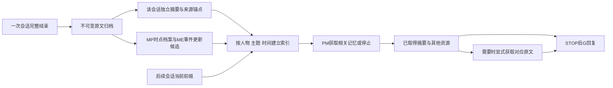

# PM-RL1 会话摘要与长期记忆设计

2026-11-16（Asia/Tokyo）。用户明确提出加入“本次完整会话结束后的 summary”尝试，并要求从问题定位推进到解决机制。本文件将 MS 会话摘要纳入新候选版本，保留旧实验原文身份；不再将完整原文规定为唯一可用的运行时表示。

## 1. 当前实现与设计修正

当前每个 MS 是**一个被取得的完整过去会话**，不是自动将全部历史注入 G。候选生成直接使用 `document.transcript`，新目录中的 `summary=None`；GET_MS 每次取得排名首项，renderer 只交付已取得的条目。11/11 的短视图是引用前后相邻轮次的摘录，不是完整会话的总结。

已核对两个 train 实物：p2_conv_10 为21轮，esc242 为43轮，当前 MS 正文与冻结完整来源逐字符一致，没有 summary。原对话正文分别为327和788个空白分词；加入每轮角色标签后的旧载荷计数为348和831，二者口径不同。代码入口：[候选物化](../../../../src/metacom_pm/paper1/multi_view_memory/candidate_adapter.py)、[MS封装](../../../../src/metacom_pm/rl1/representation.py)、[获取与交付](../../../../src/metacom_pm/rl1/resource_organization.py)。

原文完整能保证来源可追溯，但不保证模型读起来最好。长会话会产生阅读成本、重复内容及关键信息埋没；会话数量增加还会增加检索难度。新设计分别处理“每个单元过长”和“单元越来越多”两个问题。

## 2. 推荐结构：会后写摘要，运行时按需读，原文可回查

图中摘要写入与父文定向获取为新设计，尚未接入当前运行器。建库不属于在线GET；原文回查也不能免费发生。

### 2.1 写入时机与更新规则

每次会话结束，冻结原文版本，再生成该会话的摘要。第t次会话的完整摘要供第t+1次或更晚会话使用；第t次内部的任一待回复前缀都不能看到它。离线实验可以从已完成的过去会话重建摘要，但生成器不得看到后续测试问题、答案、回复或收益。

保存两种时间：来源结束/逻辑顺序，以及真实生成与就绪时间。历史数据只有日期/会话rank时，使用经过验证的严格过去rank，不伪造秒级结束时间。离线今天重建的摘要不声称历史当天已实际存在。在线摘要任务若尚未完成，条目仍不可取得；系统按已声明的RAW或无摘要路径工作，不暗中等待且漏计成本。

摘要按每段原会话独立生成并保留版本。更正摘要从相应原文重建，不不断用“上一次总摘要＋新对话”覆盖唯一记忆。新会话报告事实变化，应生成新证据，更新当前MP投影或ME事件关系；旧会话摘要仍表示当时说过什么。会话重新打开或原文修订会改变来源hash，旧摘要不得自动绑定新全文。

### 2.2 摘要应保留什么

MS-SUM保持会话过程，不能退化为一串无关系事实。主体是一段可读的英文总结，必要时附简短条目：

- 本次主要处境、明确情绪表达、人物关系、时间和重要转折。
- 用户明确的诉求、现实限制、拒绝或偏好，保留它们的适用范围。
- 支持者提过什么；用户只是考虑、已经尝试，还是明确报告了反应。
- 哪些困难仍未解决、哪些事项只是计划或待确认。
- 对理解有影响的否定、更正、矛盾和未知。

每个重要命题有原文轮次/跨度锚点，索引保留人名与关键实体。机械引用校验只证明锚点存在，不能证明概括忠实，仍需语义检查。G的紧凑正文不附全部引文与审核日志；这些放在来源侧表，否则“摘要＋所有原文引用”可能比原会话还长。评估必须量实际交付正文，不能只量其中的摘要段落。

不预设固定200字或固定压缩比就是最优。先保留支持判断所需信息，再比较长度与质量；困难会话允许更长摘要。特别长的原会话若超出写入器上下文，后续采用保持话题/事件边界的分段，保留指代和源跨度；不把任意等长切块再合并视为已解决保真问题。

示例：历史说“挂过电话，但朋友很生气”，摘要保留尝试及不良反应；不能写成用户避免挂电话。结尾致谢不能被总结成问题已解决。一次“画画不适合我”不能推成永远排斥所有创作活动。

### 2.3 与MP、ME的分工

| 视图 | 回答的问题 | 更新方式 |
|---|---|---|
| MP | 截至此刻哪些个人事实仍成立？ | 从原文证据更新时点投影，保留更正/冲突 |
| ME | 发生过什么、做到哪一步、本人报告什么反应？ | 追加或连接有依据的事件状态 |
| MS-SUM | 那一次对话整体谈了什么、怎样发展、留下什么？ | 每会话独立生成；原文、摘要内容或写入器配置改变时另立版本 |
| MS-RAW | 当时具体怎么说，摘要省略了什么？ | 完整归档，按需取得 |

不先把原文压成摘要再仅从摘要提取MP/ME，否则一个遗漏会传播到全部视图。可以共用一次建库生成来降低成本，但各视图的命题都应直接绑定原文，语义和身份分别验证。重复信息通过来源关联处理，不因为同源而删除不同语境。

## 3. 长历史增长的实际处理机制

**第一，摘要减少单次会话的阅读体积。第二，检索和停止控制本轮读取哪些会话。第三，档案/事件视图使简单需求不必每次重读会话。**三者共同处理增长问题，仅把全文改成摘要而继续全部拼接，仍会越来越长。

最初保持固定共享BGE与来源/时点过滤；同时保留原文关键词和实体的检索入口，避免摘要删掉的罕见信息永远无法被找到。检索器内部可以使用完整合法索引，但不向PM免费暴露候选正文/向量。索引成本单列；不将一次查询必须扫描全库当成最终实现。

运行时检索相关单元，PM决定继续取得还是STOP；原生上下文边界保持不变，不借本次摘要设计偷偷恢复top-4或四次GET硬限制。需要实际部署的延迟操作点时，根据共同质量—等待曲线选择，不能把未经测试的任意长度写成最佳。

不默认“越旧越无用”，也不靠删除旧原文控制上下文。旧信息可以退出常用工作视图、进入归档索引；事实的当前有效性与来源的新旧分别处理。高频跨会话主题的专题总览是后续候选，不先增加一层可能失真的滚动总摘要。若新增专题总览，必须从可追溯来源重建，按目标时点版本化。

## 4. 用可实施的机制修复问题

| 问题 | 本次设计的解决机制 | 验收 |
|---|---|---|
| 完整会话冗长、关键信息埋没 | 会后独立生成任务相关但不看未来问题的会话摘要 | 同源RAW/SUM下的保真、帮助性及真实在线成本 |
| 历史越积越多 | 分层索引、按需读取、MP/ME直接读取常用事实/事件 | 随合法历史量增加的召回、成本与漏用曲线 |
| 压缩丢失指代、否定和行动阶段 | 自足陈述、原文锚点、保留未知；不合格摘要拒收 | 固定反例与实际源文语义审查，不以引用命中率冒充保真 |
| 摘要遗漏，后续无法恢复 | 保留原文索引与显式同源回查 | 查回正确父文、恢复所需信息、实际计入读取与生成成本 |
| 多次归纳产生漂移 | 每会话原文独立写入；修改从原文重建 | 版本hash绑定，旧摘要不被未来事实污染 |
| 原文中的建议被写成执行结果 | 写入schema区分建议/意向/行动/自报反应 | 挂电话、工作坊、社群等已发现反例通过 |
| G仍把旧记忆当现在事实 | 渲染时保留“当时报告”、时间与当前未知；必要时条件监督 | 同前缀相关/无关资源下事实误用及帮助性 |
| 资料正确但效果仍一般 | 在同版本实验中查是否需要不同表示/取量/执行适配 | 不把低质量单一摘要器的失败概括成所有摘要无效 |

RS沿用方法—案例两层设计。新的MS摘要保留过去支持行动及用户反应，使后续RS能结合已尝试/拒绝的方式调整建议；但不能将个人历史变成某种方法的因果疗效标签。

## 5. 两阶段比较，第一步可以直接接入现有研究

### S1：只比较表示

同一个合法目标前缀、同一组源会话、同一排序、同G/基础指导，比较OFF、RAW、SUM。可加SUM＋同源RAW作为遗漏/冲突诊断；它是固定提供两者的条件，不是自动回查系统。与其他记忆类型共同测试时，MP/ME保持相同；RS先保持相同状态，不扩成“所有RS条件×所有摘要器”的大网格。

S1不因摘要更短而多给它几段会话，不根据待答金标制作摘要，也不根据G结果选摘要。固定源列表意味着本阶段不评价自适应查询更新；来源排序冻结于公共前缀。只在RAW/SUM均可完整交付的共同可行集合做配对，超容量单列覆盖结果，不裁短RAW或静默删困难样本。这样回答“同一资料的摘要表示是否更合用”。

第一批可复用昨天24段固定合法源会话制作候选；目前只做3段真实来源的人工式样例来检查schema，不冒充自动摘要器基准。正式比较前再冻结统一写入模型/提示、源列表、实际token、盲评与预算。摘要建库一次，绑定来源后供多个合法后续前缀复用。

### S2：比较实际系统

再比较RAW读取、SUM读取、SUM＋可选原文回查三种系统。允许摘要系统在共同原生容量下取得更多会话，但要测真实质量—等待曲线，并披露因表示而改变的可达域。这是系统收益，不混入S1的表示效应。

当前GET_MS不能定向回查父会话。建议在独立混合接口中新增 `EXPAND_MS(j)`：j只指已取得摘要的可见序号，内部解析为其父原文；不能用私有来源ID作为policy输入。未取得的摘要、已展开条目或超容量原文不可扩读。取得原文后既有摘要仍保留并计费，不暗中退款或把摘要替换掉。若单个父原文无法在原生上下文内完整交付，标不可行；片段级回查是另一种明确表示，不能伪称完整MS。

这一扩展不是本轮已实现的动作，也不加入S1。混合域中的OneShot、简单停止、BC/PPO都应得到相同获取能力与成本。若选择共享的确定性父文优先规则替代新动作，同样另立版本，不能只给PPO特权。

## 6. 成本和判定

分别报告：写入摘要的生成/核验/索引成本；每次查询的检索/PM/编码/G成本；回查率；完整客户端时间。摘要缓存不是免费训练数据；源hash或写入器版本变化后需要重新绑定。

生命周期成本可写为：`一次写入成本 + N次后续查询的在线成本总和`。摊销只使用实际或明确假设的N，并同时报告没有再次访问的会话。会后异步建库减少当前响应路径的负担，不等于建库成本消失；GPU争用也可能影响后续响应。

衡量源文保真与遗漏、G误用/重复无效建议、当前帮助性、实际token与等待。不能只用摘要相似度、压缩率或ES-MemEval Summary分数决定胜负。新的RS/自然支持主研究继续，摘要比较作为记忆表示子实验接入，不要求先解决所有长期记忆问题才能推进其他模块。

## 7. 可借鉴的现有工作

[递归摘要研究](https://arxiv.org/abs/2308.15022)支持将摘要作为长对话记忆候选；其结果不保证当前支持任务收益。本项目第一版选每会话独立摘要，以便保留原文、定位错误并避免唯一滚动摘要被覆盖。

[LongMemEval作者报告](https://xiaowu0162.github.io/long-mem-eval/)比较了记忆粒度、索引和时间处理，并发现过度事实压缩可能损失信息。因此保留RAW及查询索引对照，不预设越短越好。

本轮还核对了[FTA-Mem](https://arxiv.org/abs/2608.16303v2)：它针对低信息密度的支持历史，提出保持边界的情境片段和事实/时间/情感单元，在ES-MemEval与LoCoMo报告记忆QA结果。可借其连贯片段思路解决长会话分段，不能把QA结果当成本项目帮助性或PM增益，也不能将“支持记忆压缩”本身声称为新的贡献。本轮未核验其代码可用性，不列为必须先接入的依赖。

## 8. 本轮交付与范围

已核实当前RAW行为，并形成[写入提示候选](SUMMARY_WRITER_PROMPT_EN.md)、[协议与执行清单](SESSION_SUMMARY_PROTOCOL.json)和[三个完整来源摘要样例](../../../../outputs/pm_rl1/session_summary_design_20261116_v1/examples/README_ZH.md)。样例由助手阅读原文撰写，未运行拟部署摘要器，不是独立质量金标。

本轮用户指令覆盖旧MS定义在新候选实验中的限制。旧MS_RAW、旧结果和旧缓存保持原身份；SUM输入、renderer、检索或混合动作变化均需要新identity和对应测量。新摘要器不使用ES-MemEval自带summary/observation/gold字段，不读取当前目标未来内容。先行阶段不改变单轮PM终值目标，也不引入多轮未来奖励或联合在线训练。

下一实际实现按顺序是：版本化summary正文/来源绑定与校验 → 同源RAW/SUM物化及离线payload预检 → 冻结写入器与小批量表示实验 → 接共享检索 → 如有必要实现混合回查接口。当前仅候选设计与样例落盘，生产接口和旧资源库未改。
